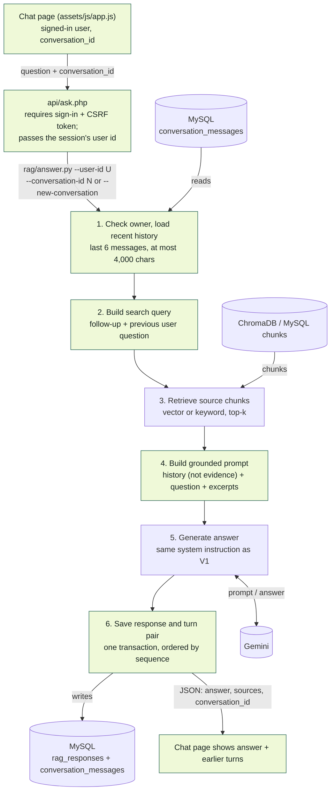
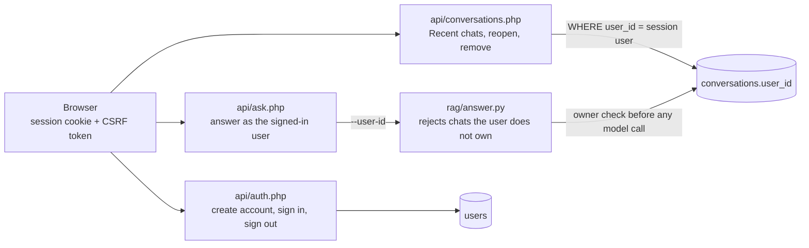
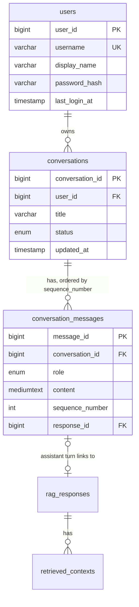

# Conversation Memory Architecture (V2.0)

Chat remembers earlier turns within one conversation, so a follow-up such as
"What GPA do they need?" retrieves the right Metro State documents. Each
conversation belongs to one signed-in user: users see only their own Recent
chats and can reopen one to continue where they left off. This
implements section 5 of the
[FP3 V2 architecture plan](FP3_RAG_Evals_V2_Architecture_Plan.md) using the
`conversations` and `conversation_messages` tables from migration 008.

Evaluation runs pass no conversation, so they skip the memory steps and their
prompts are byte-identical to Version 1. Gold Standard and final-study results
stay comparable.

## Request flow



Highlighted steps were added or changed for memory; retrieval and generation
are the unchanged V1 steps.

## User accounts



- **Accounts.** `users` stores a unique username, a display name and a
  `password_hash()` hash (bcrypt). Passwords need 8 to 72 characters.
  `ALLOW_ACCOUNT_REGISTRATION=0` turns off self-service sign-up.
- **Sessions.** PHP sessions with an HttpOnly, SameSite=Lax cookie. The session
  id is regenerated at sign-in and sign-out to prevent session fixation.
- **CSRF.** Every state-changing request (sign in, sign out, ask, remove) must
  send the session's token in the `X-CSRF-Token` header; the page adds it to
  every request automatically.
- **Ownership.** `conversations.user_id` links each chat to its owner. The list
  and reopen queries filter by the session user, and `rag/answer.py` checks the
  owner again before loading history or saving a turn, so a chat id from another
  user behaves exactly like a missing chat (404) and never triggers a paid call.
- **Who needs to sign in.** Asking a question saves it to history, so it needs
  an account. "Preview sources" saves nothing and still works signed out.
  Documents, Gold Standard and Evaluation stay a shared research workspace.
- **Remove.** Removing a chat archives it: it leaves Recent chats, but its
  messages and saved answers stay for research.
- **Upgrade.** `initialize_schema()` adds `users`, `conversations.user_id`, its
  index and foreign key to existing databases. Migration 010 archives chats
  saved before accounts existed, since they have no owner.

## Data model



Answers, sources, and costs stay in `rag_responses` / `retrieved_contexts`;
messages link to them instead of copying them.

## Worked example

| Turn | Student asks | Searched for |
| --- | --- | --- |
| 1 | What are the first-year admission requirements? | What are the first-year admission requirements? |
| 2 | What GPA do they need? | What are the first-year admission requirements? What GPA do they need? |

"They" marks turn 2 as a follow-up, so the search joins it with the previous
question. The model still answers the question as typed and sees earlier turns
only as context.

## Design decisions

- **Bounded window.** Last 6 messages (3 exchanges), at most 4,000 characters,
  so cost stays inside the existing per-call guard.
- **No extra model call.** The follow-up query is built by a deterministic rule
  (`rag/conversation.py`), which is free, repeatable, and provider-free to test.
- **History is not evidence.** The prompt labels earlier turns as context only;
  facts must come from the excerpts and instructions in history are ignored.
- **Safe concurrency.** Saving a turn locks the conversation row so concurrent
  requests cannot claim the same sequence numbers.
- **Unknown conversations.** `answer.py` exits with status 3, `api/ask.php`
  returns 404 with `conversation_reset`, and the page starts a new conversation.

## Known limits

- Follow-up detection is a word-list heuristic; standalone questions using
  "this" or "that" may also get the previous question added to their search.
- A reopened chat shows its earlier questions and answers but not the sources
  of those older answers; sources are shown for each new answer.
- There is no password reset, account deletion page or sign-in rate limiting
  yet; these are reasonable next steps before a public deployment.
- Long conversations are trimmed, not summarized.

## Command line

```bash
python rag/answer.py "What are the first-year admission requirements?" --new-conversation --allow-paid --json
python rag/answer.py "What GPA do they need?" --conversation-id 12 --user-id 3 --allow-paid --json   # --user-id enforces ownership
python rag/answer.py "What GPA do they need?" --conversation-id 12 --dry-run --json   # no model call
```

Tests: `tests/test_conversation_memory.py` (provider-free tests, including
MySQL round trips and ownership checks) and `tests/test_user_accounts_http.py`
(end-to-end tests through the real PHP endpoints with two users; retrieval and
Gemini are replaced by `tests/fixtures/fake_answer_runner.py`).

## Evaluation data ownership

Accounts also separate evaluation data. `rag_responses.user_id` and
`evaluation_runs.user_id` record the account that saved each answer and test
run (`rag/answer.py` and `rag/run_evaluation.py` set them from the signed-in
user that the PHP endpoint passes with `--user-id`).

Every evaluation endpoint filters by the signed-in user in SQL, not only in the
browser:

| Endpoint | Enforcement |
| --- | --- |
| `api/evaluations.php` GET | Runs, saved answers, standalone Chat answers, metric summaries, run summaries, comparisons and review counts include only the user's rows. `?response_id=` returns 404 unless the user owns the answer. |
| `api/evaluations.php` POST `human_review` | 404 unless the user owns the answer. |
| `api/evaluate_standalone.php` | Citation scoring returns 404 unless the user owns the answer. |
| `api/run_evaluation.php` | 404 unless the user owns the run (and the answer belongs to that run). |
| `api/test_runs.php` | New runs belong to the user; a comparison baseline must be the user's own run. |
| `api/exports.php` | 404 unless the user owns the run. |

Another user's record is reported exactly like a missing one, so IDs cannot be
probed. The shared Gold Standard questions and evaluator definitions are not
user data and stay visible to every account.

Migration `011_evaluation_ownership.sql` assigns owners without deleting
anything: Chat answers go to their conversation's owner and run answers to the
run's owner. Answers and runs saved before accounts stay unowned and hidden. To
give that history to one account:

```bash
python rag/claim_evaluations.py --username <name> --dry-run   # count
python rag/claim_evaluations.py --username <name>             # assign
```

`tests/test_user_accounts_http.py` signs in two accounts and checks that
neither can list, open, review, score, compare against or export the other's
records, and that the migration and claim command keep every row.

## Reliable saving of Chat answers

`rag/answer.py` saves the answer (`rag_responses` and its retrieved contexts),
a new conversation and both conversation messages in **one MySQL
transaction**. If any step fails, everything is rolled back, so the database
never holds a half-saved chat. The answer is still returned with
`saved: false`. `api/ask.php` logs the database error, removes the ids of
rolled-back rows, and adds `save_warning`. The Chat page then shows:

> Your answer was generated, but the conversation could not be saved. It may
> be lost if you refresh or leave this page.

An unsaved answer is not added to the saved thread or to Recent chats.

## Long conversations

`api/conversations.php?conversation_id=N` returns the **newest 200**
messages, oldest first, plus `has_earlier`, `earliest_sequence` and
`total_messages`. `&before_sequence=S` returns the 200 messages before `S`. The
Chat page opens a saved chat scrolled to its newest message and shows a
**Load earlier messages** button. The limit only controls what is returned;
every message stays stored in MySQL.

## Follow-up questions

Version 2.0 originally guessed follow-ups from words such as "it", "they",
"that" and "also", and joined them to the previous question. That wrongly
connected unrelated questions (for example "What does it cost to attend the
University of Minnesota?" after a Metro State admissions question).

Now, when a conversation has history, `llm.rewrite_follow_up_query` makes one
small call to the selected chat model (Gemini or Ollama, with
`QUERY_REWRITE_INSTRUCTION`). The model reads the recent window and returns a
standalone search query. A question about a new subject comes back unchanged.
The rewrite only decides what to search for; facts and citations still come
from the retrieved documents. If the call fails or returns something
unusable, the question is searched exactly as typed. Its tokens and cost are
added to the answer's recorded cost and stored in
`generation_metadata_json.conversation.query_rewrite`. Single-turn evaluation
runs have no history and make no extra call. A source preview never calls a
model, so it searches the question as typed.

## Documents and the shared library

| Data | Who sees it | Who changes it |
| --- | --- | --- |
| Shared library (`documents.user_id IS NULL`, the bundled Metro State corpus used by the Gold Standard) | Every account | Administrators (restore, delete) |
| Uploaded documents (`documents.user_id` = uploader) | The uploader only | The uploader |
| Gold Standard datasets and questions | Every account | Administrators (review status) |
| Chats, saved answers, test runs, results | The owner only | The owner |

Retrieval (`query.DocumentScope`) uses the shared library plus the signed-in
user's own uploads, in both MySQL and ChromaDB. ChromaDB is filtered with an
allow-list of source paths read from MySQL, so a chunk whose document is not
in MySQL is never returned. Signed-out source previews use the shared
library only. A test run's corpus manifest follows the same rule.

`Delete all` on the Documents page removes only the caller's uploads (and the
shared library, for an administrator). Uploads made before this change have no
owner, so they stay in the shared library until an administrator removes them.

Grant the administrator role from the command line:

```bash
python rag/manage_admins.py --grant <username>
python rag/manage_admins.py --list
```
