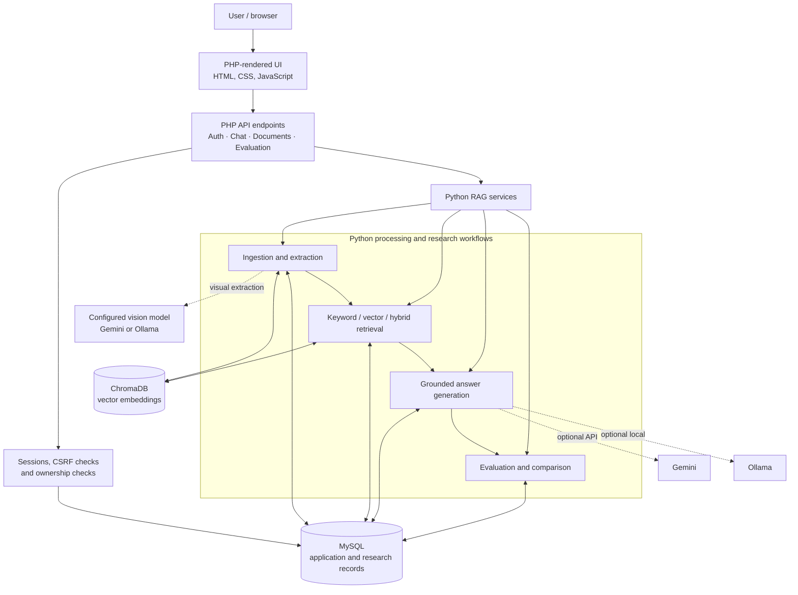
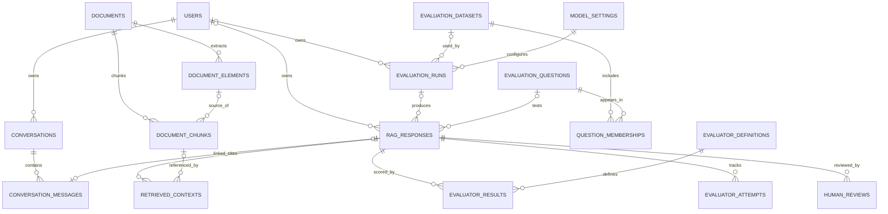
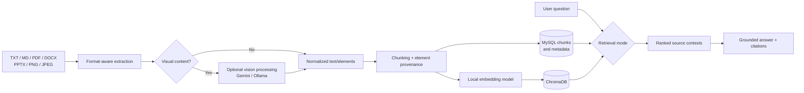

## **RAG EVAL 2.0**

**A multimodal, multi-user Retrieval-Augmented Generation (RAG) application and evaluation workbench.**

RAG EVAL 2.0 is an ICS 499 capstone project built around Metropolitan State University student-information documents. It lets users ask source-grounded questions, inspect retrieved evidence, manage a document library, maintain a reviewed answer key, and compare how different retrieval and evaluation methods perform.

The central research question is **“What is the best way to evaluate a RAG response?”** The project treats evaluation as a combination of complementary evidence—not a single universal score.

> **Project status:** A locally hosted research and demonstration application, not an official Metropolitan State University service. Its answers depend on the indexed documents and should be checked against official sources for consequential decisions.

## Contents

- [What you can do](#what-you-can-do)
- [How it works](#how-it-works)
- [Quick start](#quick-start)
- [Using the application](#using-the-application)
- [Project architecture](#project-architecture)
- [Database architecture](#database-architecture)
- [Multimodal ingestion and retrieval](#multimodal-ingestion-and-retrieval)
- [Evaluation methodology](#evaluation-methodology)
- [Configuration](#configuration)
- [Testing](#testing)
- [Project structure](#project-structure)
- [Security and limitations](#security-and-limitations)
- [Documentation and research evidence](#documentation-and-research-evidence)

## What you can do

| Area | Capabilities |
| --- | --- |
| **Accounts** | Register or sign in, maintain a user session, and access your own saved chats and evaluation results. Registration can be disabled by the operator. |
| **Chat** | Ask follow-up questions in saved conversations; inspect grounded answers, numbered citations, retrieved excerpts, and generation settings. Preview sources without invoking an LLM. |
| **Documents** | Upload, inspect, search, filter, categorize, replace, and remove indexed documents. Restore the bundled source collection. |
| **Gold Standard** | Browse and review reference questions, expected answers, required facts, source evidence, and review status. |
| **Evaluation** | Create bounded test runs from reviewed questions, inspect saved answers and retrieved contexts, apply compatible evaluators, and export evidence. |
| **Compare Runs** | Compare configurations using question-matched results, provenance, and metric-specific interpretation. |

**Supported browser uploads:** `.txt`, `.md`, `.pdf`, `.docx`, `.pptx`, `.png`, `.jpg`, and `.jpeg` (up to **10 MB** per file). Successful extraction depends on file content and the configured processors; not every visual can be interpreted reliably.

**Retrieval choices:** Chroma vector search, MySQL keyword search, and hybrid reciprocal-rank fusion (RRF). The answering pipeline can use configured Gemini or local Ollama generation; optional visual extraction supports configured Gemini/Ollama vision providers.

## How it works

1. **Index documents:** Extract text and supported visual/structural elements, then store searchable chunks in MySQL and embeddings in ChromaDB.
2. **Ask a question:** Retrieve relevant context using the selected search method and optionally generate a source-cited answer.
3. **Save the interaction:** Store conversations, answers, retrieval evidence, model settings, and provenance where applicable.
4. **Evaluate answers:** Run reviewed Gold Standard questions through the same answer pipeline, then inspect automatic metrics and human reviews.
5. **Compare results:** Compare runs under controlled changes in retrieval method, top-k, model, or corpus configuration.

## Quick start

These instructions are for **local operators and contributors**. End users only need the locally hosted application's URL and an account.

### Prerequisites

- **Python 3.11+** recommended (the CI environment uses Python 3.11).
- **PHP 8.3+** recommended, with `pdo_mysql` and `fileinfo` enabled; `proc_open` must be available for Python-backed endpoints.
- **MySQL 8.x**, running and accessible using credentials you control.
- Internet access on first setup to install packages and download the embedding model.
- **Optional:** a Gemini API key for cloud generation/vision or a running Ollama server with an appropriate installed model for local generation/vision.

The application uses PHP's built-in web server for local development. It is **not** a production deployment guide.

### 1. Clone the repository

```bash
git clone https://github.com/sjasthi/llm-rag-evals.git
cd llm-rag-evals
```

### 2. Create a Python environment and install dependencies

**Windows PowerShell**

```powershell
py -3.11 -m venv .venv
.\.venv\Scripts\python.exe -m pip install -r rag\requirements.txt
Copy-Item .env.example .env
```

**macOS / Linux**

```bash
python3 -m venv .venv
./.venv/bin/python -m pip install -r rag/requirements.txt
cp .env.example .env
```

> If Python 3.11 is not installed, use a compatible Python 3.11+ interpreter available on your machine. The first dependency/model setup can take several minutes.

### 3. Configure MySQL and `.env`

Start MySQL, then edit the **local, untracked** `.env` file:

```dotenv
DB_HOST=127.0.0.1
DB_PORT=3306
DB_NAME=llm_rag_evals
DB_USER=root
DB_PASSWORD=your_local_password

CHROMA_PATH=rag/chroma
CHROMA_COLLECTION=metrostate_documents

ALLOW_PAID_GENERATION=0
ALLOW_PAID_EVALUATION=0
```

Use a dedicated database account where practical. The repository includes a Windows helper, `scripts/start-local-mysql.ps1`, for an existing local MySQL installation; it is not required for other setups.

**Cost safety:** Model-backed generation and paid evaluation are **disabled by default**. Retrieval, document inspection, and provider-free checks can be exercised without enabling paid model calls. Model access, pricing, and explicit opt-in are discussed under [Configuration](#configuration).

### 4. Initialize and index the bundled corpus

On a **new, disposable/local database**, initialize the schema and ingest the bundled Metro State documents:

**Windows PowerShell**

```powershell
.\.venv\Scripts\python.exe rag\ingest.py --init-schema
.\.venv\Scripts\python.exe rag\evaluation.py --seed --json
```

**macOS / Linux**

```bash
./.venv/bin/python rag/ingest.py --init-schema
./.venv/bin/python rag/evaluation.py --seed --json
```

The first command creates/updates the MySQL application schema, reads the bundled corpus, and writes document chunks and vector embeddings. The second imports the versioned Gold Standard and evaluator definitions.

> **Existing database?** Back up MySQL and Chroma data first. Ingestion and schema maintenance may update existing records; do not run initialization casually against historical research data. A fresh installation does **not** automatically recreate locally saved conversations or experiment history from the tracked final-study JSON exports.

### 5. Start the web application

From the repository root, run:

```bash
php -S 127.0.0.1:8000 -t . router.php
```

Open **http://127.0.0.1:8000/**, create an account (if registration is enabled), and explore the workspace. Keep the PHP terminal open while using the app; press `Ctrl+C` to stop it.

> **Troubleshooting first:** If the UI reports unavailable application data, verify that MySQL is running, `.env` credentials are correct, and both initialization commands completed successfully.

## Using the application

| Page | Typical workflow |
| --- | --- |
| **Overview** | Check current corpus, question, and evaluation summaries. |
| **Chat** | Select a conversation or start a new one → ask a question → review answer and citations. Use **Preview Sources** for retrieval without generation. |
| **Documents** | Search or filter the indexed library → inspect a document → upload, replace, or remove sources as needed. |
| **Gold Standard** | Filter the question bank → inspect reference evidence → set review status. |
| **Evaluation** | Choose reviewed questions and a fixed configuration → preview or create a bounded test → inspect saved responses → score eligible answers and export results. |
| **Compare Runs** | Choose comparable runs → review question-matched changes and each metric's scope. |

A **Gold Standard question** is the reviewed reference input. A **test run** is a group of generated answers under one configuration. **Scoring saved answers** reuses stored answers where supported rather than necessarily generating them again.

## Project architecture

The browser communicates with PHP endpoints; PHP handles sessions, validation, and orchestration. Python implements document processing, retrieval, answer generation, and evaluation. MySQL and ChromaDB are complementary storage systems.



**Key implementation paths:** `index.php`, `assets/js/app.js`, `api/`, `includes/auth.php`, `rag/ingest.py`, `rag/query.py`, `rag/answer.py`, and `rag/evaluation.py`.

**Deployment boundary:** PHP, MySQL, ChromaDB, and the application files run locally in this development setup. When Gemini is selected, relevant model inputs are transmitted to an external provider; Ollama can support locally hosted inference.

## Database architecture

MySQL records the application state, document structure, conversations, answer provenance, and evaluator outputs. ChromaDB stores the searchable embedding vectors associated with document chunks. The following is a **simplified conceptual ER diagram**, not every column or relationship in the SQL schema.



**How the storage layers relate:**

- **MySQL:** `documents`, `document_elements`, and `document_chunks` describe the index. Each chunk can carry a `chroma_id` that identifies its vector record in ChromaDB.
- **Conversation ownership:** `users` → `conversations` → `conversation_messages`; assistant messages can link to `rag_responses`.
- **Evaluation ownership:** `evaluation_runs` and `rag_responses` include nullable `user_id` fields. The Evaluation API restricts saved runs/responses to the signed-in owner.
- **Research provenance:** `retrieved_contexts` preserves excerpts, ranks, retrieval scores, and snapshots. Evaluator results, attempts, and human reviews are recorded separately.
- **Shared content:** The indexed document corpus and Gold Standard question bank are shared application resources; account isolation applies to owned conversation and evaluation history, **not** to every dataset or document.

The authoritative, complete schema is [`database/schema.sql`](database/schema.sql). Incremental migration scripts are in [`database/migrations/`](database/migrations/); account ownership changes are covered by migrations `010_user_accounts.sql` and `011_evaluation_ownership.sql`.

## Multimodal ingestion and retrieval



The ingestion code distinguishes **document elements** (for example text, tables, diagrams, and extracted image descriptions) from **retrieval chunks**, retaining page/content/extraction metadata where available. Format-specific handlers live in `rag/pdf_processor.py`, `rag/markdown_processor.py`, `rag/docx_processor.py`, `rag/pptx_processor.py`, and `rag/image_processor.py`.

Retrieval options:

- **`chroma_vector`** — semantic nearest-neighbor search over local embeddings.
- **`mysql_keyword`** — lexical retrieval using the MySQL-backed document index.
- **`hybrid_rrf`** — combines ranked lexical and vector results using reciprocal-rank fusion.

Results feed the **same grounded-answer pipeline** used by interactive Chat and controlled evaluation runs. Extraction quality, model availability, and source relevance affect the answer; a successful upload does not guarantee complete understanding of every image, chart, or page.

## Evaluation methodology

The app compares complementary ways to assess **correctness, completeness, grounding, retrieval quality, relevance, refusal behavior, and operational characteristics**.

| Evaluation layer | Purpose | Consideration |
| --- | --- | --- |
| **Provider-free/local metrics** | Fast, reproducible screening using lexical, semantic, and retrieval signals. | Individual metrics measure limited aspects of quality. |
| **LLM-as-judge** | Structured assessment of answers for selected cases. | Requires configured model access and careful validation. |
| **RAGAS metrics** | Diagnose specific retrieval/answer properties. | May require model calls and suitable reference/context inputs. |
| **Human review** | Evaluate nuanced or disputed cases and audit metric disagreement. | Requires a consistent rubric and reviewer judgment. |

The repository defines **13 automated evaluators** across these layers (eight local metrics, one structured judge, and four RAGAS metrics), plus a separate human-review rubric. Not every metric applies to every saved response. The UI distinguishes completed, skipped, and failed results rather than treating missing values as zero.

The versioned Gold Standard includes a **50-question v2.0 dataset** with reviewed answers and supporting evidence. The repository also contains six JSON exports from a bounded controlled study; these are **historical evidence**, not data automatically loaded as new runtime runs.

For the exact score contracts and study interpretation, see [Evaluation strategy](docs/V1%20docs/evaluation-strategy.md), [Final study report](docs/V1%20docs/final-study-report.md), and [portable final-study exports](data/evaluation/final-study/README.md).

## Configuration

Copy `.env.example` to `.env` and edit only the local file. Selected settings:

| Variable | Purpose |
| --- | --- |
| `DB_HOST`, `DB_PORT`, `DB_NAME`, `DB_USER`, `DB_PASSWORD` | MySQL connection. |
| `CHROMA_PATH`, `CHROMA_COLLECTION` | Persistent local vector collection. |
| `EMBEDDING_MODEL`, `CHUNK_SIZE`, `CHUNK_OVERLAP` | Embedding and chunking defaults. |
| `LLM_PROVIDER`, `LLM_CHAT_MODEL`, `LLM_CHAT_MODELS` | Generation provider and browser-approved models. |
| `GEMINI_API_KEY` / `LLM_API_KEY` | Optional API credentials for Gemini-backed calls. |
| `VLM_PROVIDER`, `VLM_MODEL`, `OLLAMA_BASE_URL` | Visual extraction provider/model and local Ollama address. |
| `ALLOW_ACCOUNT_REGISTRATION` | Whether users may register themselves. |
| `ALLOW_PAID_GENERATION`, `ALLOW_UNKNOWN_GENERATION_COST`, `MAX_GENERATION_COST` | Generation opt-in and single-call cost policy. |
| `ALLOW_PAID_EVALUATION`, `ALLOW_UNKNOWN_EVALUATION_COST`, `MAX_EVALUATION_COST` | Evaluator opt-in and cost policy. |
| `MAX_TEST_RUN_RESPONSES`, `MAX_EVALUATOR_APPLICATIONS` | Browser-run safety bounds. |

**Important:** Zero configured pricing is treated as *unknown*, not proof that a provider is free. Keep paid generation and evaluation disabled until keys, available models, provider pricing, and budget limits have been checked. The model IDs in `.env.example` are example deployment settings and may need updating when providers change available model names. For local Ollama operation, install and run the relevant models separately.

## Testing

Tests can run without authorizing paid model calls. Some integration tests need the initialized local MySQL/Chroma fixtures.

**Windows PowerShell**

```powershell
.\.venv\Scripts\python.exe -m pytest tests -v -p no:cacheprovider
node --check assets/js/app.js
php -l index.php
```

**macOS / Linux**

```bash
./.venv/bin/python -m pytest tests -v -p no:cacheprovider
node --check assets/js/app.js
php -l index.php
```

The [GitHub Actions quality workflow](.github/workflows/quality.yml) also covers Python compilation, provider-free tests, PHP linting, account endpoint checks, JavaScript syntax, and a seeded integration smoke test.

## Project structure

```text
llm-rag-evals/
├── index.php                 # Main browser workspace
├── router.php                # Development-server path restrictions
├── assets/                   # Frontend JavaScript and CSS
├── api/                      # Auth, Chat, documents, evaluation endpoints
├── includes/                 # Shared PHP components and auth helpers
├── config/                   # Local configuration loaders
├── rag/                      # Python ingestion, retrieval, models, evaluation
│   ├── vlm_providers/        # Visual model adapters
│   └── chroma/               # Local vector-storage location
├── database/
│   ├── schema.sql            # Authoritative MySQL schema
│   └── migrations/           # Incremental schema/data updates
├── data/
│   ├── metrostate_documents/ # Bundled source corpus
│   └── evaluation/           # Gold Standard datasets and study exports
├── docs/                     # Architecture, research, reports, screenshots
├── tests/                    # Automated and manual validations
├── scripts/                  # Local development helpers
├── storage/                  # Runtime uploads and logs (do not commit data)
└── .env.example              # Configuration template
```

## Security and limitations

- **Local research deployment:** PHP's built-in server is for development only. Do not expose it directly to the public Internet.
- **Authentication and ownership:** Passwords are hashed; PHP sessions and CSRF protections guard state-changing actions. Saved conversations and evaluation records are scoped to their owners. Shared documents/Gold Standard data are not private per-user workspaces.
- **Uploaded files:** The endpoint checks extension/MIME compatibility and enforces a 10 MB limit. Treat uploaded content as untrusted and avoid indexing confidential material without an appropriate deployment/security review.
- **Cost and network access:** Gemini-backed operations may send source excerpts or image content to an external service and may incur charges; Ollama supports local alternatives when configured.
- **Historical data:** Pre-account records may have `NULL` ownership and remain hidden until explicitly assigned using the administrative ownership workflow. Back up MySQL and Chroma before migrations, re-ingestion, or deletion.
- **Model reliability:** RAG answers and visual extraction can be incomplete or inaccurate. Citations indicate retrieved evidence, not guaranteed factual correctness.
- **Scope:** This is a source-grounded research chatbot and evaluation tool; it is not an autonomous agent or an official university information system.

Never commit `.env`, API credentials, database passwords, runtime uploads, or private user data.

## Documentation and research evidence

### Architecture and design
- [RAG EVAL 2.0 System Architecture](docs/V2%20docs/RAG_EVAL_2_0_System_Architecture.md) — detailed system design, component interactions, security boundaries, and end-to-end workflows.
- [RAG EVAL 2.0 Database Schema](docs/V2%20docs/RAG_EVAL_2_0_Database_Schema.md) — detailed documentation of the V2 MySQL database tables, relationships, and schema design.
- [Multimodal RAG Pipeline Architecture](docs/V2%20docs/Multimodal_RAG_Pipeline_Architecture_final.pdf) — architecture diagram illustrating the multimodal ingestion, indexing, retrieval, and answer-generation workflows.
- [Conversation memory architecture](docs/V2%20docs/Conversation_Memory_Architecture.md) — conversational design context.


### Research and validation
- [Evaluation Methodology](docs/V2%20docs/RAG_EVAL_2_0_Evaluation_Methodology.md) — evaluation metrics, scoring methods, controlled experiments, and human review.
- [V1 vs. V2 Ingestion Pipeline](docs/V2%20docs/RAG%20Document%20Ingestion_%20V1%20vs%20V2.png) — comparison of the original V1 text-only ingestion pipeline with the expanded multimodal V2 implementation.
- [Multimodal testing report](docs/V2%20docs/RAG_EVAL_2_Multimodal_Testing_Report.pdf) — format-specific validation evidence.

### Development
- [Setup and Troubleshooting Guide](docs/V2%20docs/RAG_EVAL_2_0_Developer_Guide.md) — installation instructions, environment configuration, application verification, and troubleshooting.
- [License](LICENSE) — repository license.**

---

**For contributors:** Please keep this README aligned with the implemented code, update diagrams when storage/ownership flows change, and distinguish **implemented features** from **planned enhancements**.
