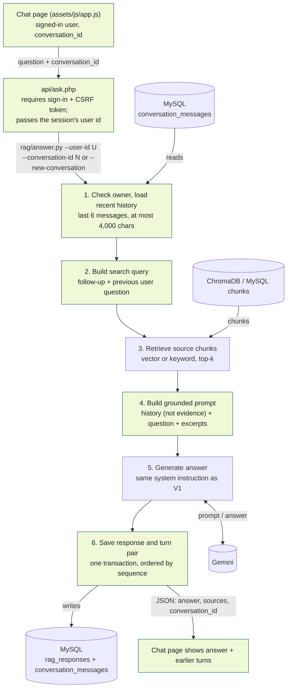
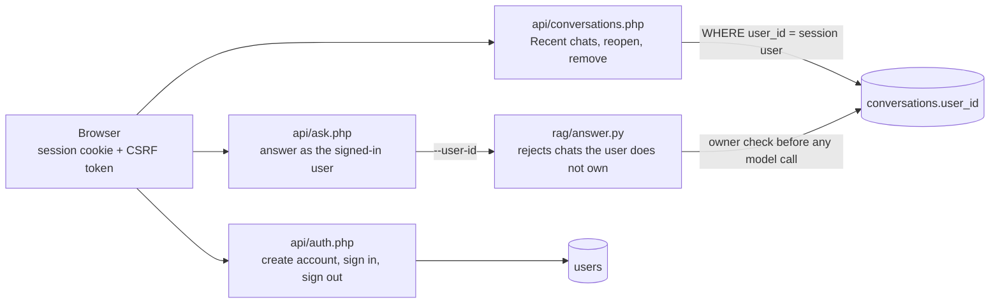
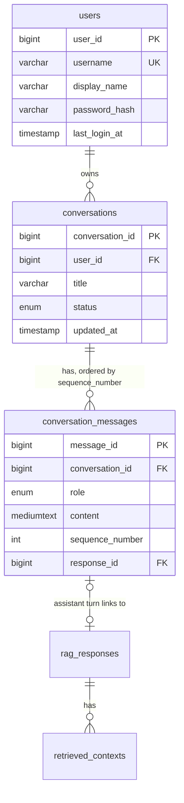

# Conversation Memory Architecture (V2.0)

Chat remembers earlier turns within one conversation, so a follow-up such as
"What GPA do they need?" retrieves the right Metro State documents. Each
conversation belongs to one signed-in user: users see only their own Recent
chats and can reopen one to continue where they left off. This
implements section 5 of the
[FP3 V2 architecture plan](FP3_RAG_Evals_V2_Architecture_Plan.md) using the
`conversations` and `conversation_messages` tables from migration 008.

Evaluation runs pass no conversation, so they skip the memory steps and their
prompts are byte-identical to Version 1. Gold Standard and final-study results
stay comparable.

## Request flow



Highlighted steps were added or changed for memory; retrieval and generation
are the unchanged V1 steps.

## User accounts



- **Accounts.** `users` stores a unique username, a display name and a
  `password_hash()` hash (bcrypt). Passwords need 8 to 72 characters.
  `ALLOW_ACCOUNT_REGISTRATION=0` turns off self-service sign-up.
- **Sessions.** PHP sessions with an HttpOnly, SameSite=Lax cookie. The session
  id is regenerated at sign-in and sign-out to prevent session fixation.
- **CSRF.** Every state-changing request (sign in, sign out, ask, remove) must
  send the session's token in the `X-CSRF-Token` header; the page adds it to
  every request automatically.
- **Ownership.** `conversations.user_id` links each chat to its owner. The list
  and reopen queries filter by the session user, and `rag/answer.py` checks the
  owner again before loading history or saving a turn, so a chat id from another
  user behaves exactly like a missing chat (404) and never triggers a paid call.
- **Who needs to sign in.** Asking a question saves it to history, so it needs
  an account. "Preview sources" saves nothing and still works signed out.
  Documents, Gold Standard and Evaluation stay a shared research workspace.
- **Remove.** Removing a chat archives it: it leaves Recent chats, but its
  messages and saved answers stay for research.
- **Upgrade.** `initialize_schema()` adds `users`, `conversations.user_id`, its
  index and foreign key to existing databases. Migration 010 archives chats
  saved before accounts existed, since they have no owner.

## Data model



Answers, sources, and costs stay in `rag_responses` / `retrieved_contexts`;
messages link to them instead of copying them.

## Worked example

| Turn | Student asks | Searched for |
| --- | --- | --- |
| 1 | What are the first-year admission requirements? | What are the first-year admission requirements? |
| 2 | What GPA do they need? | What are the first-year admission requirements? What GPA do they need? |

"They" marks turn 2 as a follow-up, so the search joins it with the previous
question. The model still answers the question as typed and sees earlier turns
only as context.

## Design decisions

- **Bounded window.** Last 6 messages (3 exchanges), at most 4,000 characters,
  so cost stays inside the existing per-call guard.
- **No extra model call.** The follow-up query is built by a deterministic rule
  (`rag/conversation.py`), which is free, repeatable, and provider-free to test.
- **History is not evidence.** The prompt labels earlier turns as context only;
  facts must come from the excerpts and instructions in history are ignored.
- **Safe concurrency.** Saving a turn locks the conversation row so concurrent
  requests cannot claim the same sequence numbers.
- **Unknown conversations.** `answer.py` exits with status 3, `api/ask.php`
  returns 404 with `conversation_reset`, and the page starts a new conversation.

## Known limits

- Follow-up detection is a word-list heuristic; standalone questions using
  "this" or "that" may also get the previous question added to their search.
- A reopened chat shows its earlier questions and answers but not the sources
  of those older answers; sources are shown for each new answer.
- There is no password reset, account deletion page or sign-in rate limiting
  yet; these are reasonable next steps before a public deployment.
- Long conversations are trimmed, not summarized.

## Command line

```bash
python rag/answer.py "What are the first-year admission requirements?" --new-conversation --allow-paid --json
python rag/answer.py "What GPA do they need?" --conversation-id 12 --user-id 3 --allow-paid --json   # --user-id enforces ownership
python rag/answer.py "What GPA do they need?" --conversation-id 12 --dry-run --json   # no model call
```

Tests: `tests/test_conversation_memory.py` (provider-free tests, including
MySQL round trips and ownership checks) and `tests/test_user_accounts_http.py`
(end-to-end tests through the real PHP endpoints with two users; retrieval and
Gemini are replaced by `tests/fixtures/fake_answer_runner.py`).
