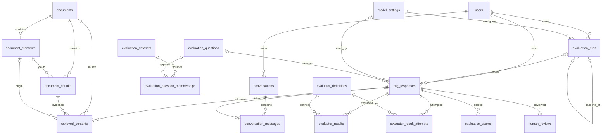

# RAG EVAL 2.0 — Database Schema Reference

> **Source of truth:** inspected repository `database/schema.sql`, `rag/database.py`, and `database/migrations/001`–`011` from `llm-rag-evals-main(12).zip` (November 24, 2026). This describes the **declared and initialized schema**, not a live database inspection. Existing deployments may differ until initialization/migrations run.

## 1. Overview

RAG EVAL 2.0 extends the V1 relational MySQL data model instead of replacing it. The default database is `llm_rag_evals` (UTF-8 `utf8mb4`, collation `utf8mb4_unicode_ci`); the application can select a different database with `DB_NAME`. The schema has **19 MySQL tables** divided into document ingestion, user conversations, RAG responses and provenance, evaluation, and schema maintenance. **ChromaDB is a separate vector store**, not a MySQL table; `document_chunks.chroma_id` connects relational chunks to indexed vectors.

### What changed in V2

- **Multimodal source provenance:** `document_elements` records ordered source elements, their page, type, normalized searchable content and extraction technique. `document_chunks.element_id` and `retrieved_contexts.element_id` connect indexed and retrieved evidence to these elements.
- **Persistent multi-turn chat:** `conversations` groups ordered `conversation_messages`; assistant messages can link to a saved `rag_responses` record through `response_id`.
- **Accounts and ownership:** `users`, `conversations.user_id`, `evaluation_runs.user_id`, and `rag_responses.user_id` support per-account access. Legacy unowned records are preserved with `NULL` owner values.
- **Hybrid retrieval:** `model_settings.retrieval_method` and `rag_responses.retrieval_method` support `mysql_keyword`, `chroma_vector`, and `hybrid_rrf`.
- **Reproducible chunking:** `model_settings.chunking_strategy` and `chunking_configuration_json` supplement V1 chunk-size/overlap fields.
- **Preserved FP7–FP10 evaluation records:** datasets, settings, runs, answers, context snapshots, evaluator attempts, and human review remain in the relational schema.

## 2. Table inventory

| Area | Tables | Role |
|---|---|---|
| Documents and retrieval | `documents`, `document_elements`, `document_chunks` | Source files, extracted multimodal units, searchable chunks |
| Accounts and chat | `users`, `conversations`, `conversation_messages` | Accounts, chat sessions, ordered messages |
| RAG answers and evidence | `rag_responses`, `retrieved_contexts` | Generated answers and cited/ranked retrieval evidence |
| Evaluation datasets and runs | `evaluation_questions`, `evaluation_datasets`, `evaluation_question_memberships`, `model_settings`, `evaluation_runs` | Ground truths, dataset membership, experiment configuration and runs |
| Scores and reviews | `evaluation_scores`, `evaluator_definitions`, `evaluator_results`, `evaluator_result_attempts`, `human_reviews` | Automated and human assessment |
| Maintenance | `schema_migrations` | Applied migration ledger |

## 3. Entity relationships



**Reading the diagram:** optional relationships arise from nullable foreign keys. The diagram is conceptual; it does not reproduce every unique key or cascade rule. The one-to-one optional message-to-response link reflects the unique `conversation_messages.response_id`, while not every RAG response is a chat answer.

## 4. Core workflows and data lifecycle

### A. Ingestion and retrieval

1. A source file is registered in `documents` (name, path, source type, status, hash, ingestion settings).
2. V2 extraction creates ordered `document_elements` for content such as text, tables, charts, diagrams, and images; `normalized_content` stores the text representation used downstream, not the original binary image.
3. `document_chunks` holds retrieval-ready text, optionally points to the element that produced it, and may store a `chroma_id` used in the Chroma vector index. MySQL FULLTEXT indexes `chunk_text` for lexical search.
4. When a query produces an answer, `rag_responses` stores its answer and generation metadata. `retrieved_contexts` records ranked evidence, scoring fields, excerpts, source references, and frozen provenance snapshots.

### B. Accounts and multi-turn conversations

1. `users` holds unique usernames, display names, and password **hashes** (not plaintext passwords).
2. `conversations` associates an active/archived chat with a user. Each chat has zero or more ordered `conversation_messages`.
3. Messages have a `role` of `user` or `assistant`; `(conversation_id, sequence_number)` is unique. An assistant message may point to its `rag_responses` answer, which in turn links to retrieved evidence and evaluations.
4. The repository adds nullable ownership columns to `evaluation_runs` and `rag_responses`; the Evaluation API limits visibility by signed-in user. A nullable owner does **not** mean publicly readable.

### C. Evaluation

1. `evaluation_questions` stores reviewed prompts, reference answers, accepted answers, required facts, and metadata.
2. `evaluation_datasets` versions collections of questions; `evaluation_question_memberships` is a many-to-many bridge that preserves question order.
3. `model_settings` represents retrieval/model/chunking configuration. `evaluation_runs` records the dataset, settings, optional comparison baseline, corpus variant, status, and timestamps.
4. `rag_responses` stores answers associated with runs and/or questions. `evaluation_scores` preserves summary scores; `evaluator_results` stores the current result per evaluator and response, while `evaluator_result_attempts` keeps numbered attempts with provider output, token use, settings, and error details. `human_reviews` holds rubric-based reviews.

## 5. Detailed table reference

All columns below come from the repository's `database/schema.sql`. Types, nullability, defaults, and keys are shown as declared there. Application initialization can add missing fields and constraints to **existing** installations. `PK` = primary key; `FK` = foreign key; `UQ` = unique; `IDX` = index; `FT` = FULLTEXT. In MySQL, `BOOLEAN` is a synonym for `TINYINT(1)`.

### `documents`

Source-file registry and ingestion lifecycle.

| Column | SQL declaration |
|---|---|
| `document_id` | `BIGINT UNSIGNED AUTO_INCREMENT PRIMARY KEY` |
| `title` | `VARCHAR(255) NOT NULL` |
| `category` | `VARCHAR(100) NOT NULL` |
| `source_path` | `VARCHAR(500) NOT NULL` |
| `source_type` | `VARCHAR(50) NOT NULL DEFAULT 'txt'` |
| `original_filename` | `VARCHAR(255) NULL` |
| `status` | `ENUM('pending', 'ingested', 'failed', 'archived') NOT NULL DEFAULT 'pending'` |
| `source_hash` | `CHAR(64) NULL` |
| `chunk_size` | `INT UNSIGNED NULL` |
| `chunk_overlap` | `INT UNSIGNED NULL` |
| `ingestion_error` | `TEXT NULL` |
| `imported_at` | `TIMESTAMP NULL` |
| `created_at` | `TIMESTAMP NOT NULL DEFAULT CURRENT_TIMESTAMP` |
| `updated_at` | `TIMESTAMP NOT NULL DEFAULT CURRENT_TIMESTAMP ON UPDATE CURRENT_TIMESTAMP` |

**Notes:** The `source_path` value must be unique. `status` is `pending`, `ingested`, `failed`, or `archived`.

### `document_elements`

Ordered multimodal elements extracted from documents.

| Column | SQL declaration |
|---|---|
| `element_id` | `BIGINT UNSIGNED AUTO_INCREMENT PRIMARY KEY` |
| `document_id` | `BIGINT UNSIGNED NOT NULL` |
| `element_index` | `INT UNSIGNED NOT NULL` |
| `page_number` | `INT UNSIGNED NULL` |
| `content_type` | `VARCHAR(40) NOT NULL DEFAULT 'text'` |
| `normalized_content` | `MEDIUMTEXT NOT NULL` |
| `extraction_method` | `VARCHAR(80) NOT NULL` |
| `extraction_model` | `VARCHAR(120) NULL` |
| `created_at` | `TIMESTAMP NOT NULL DEFAULT CURRENT_TIMESTAMP` |

**Notes:** Unique `(document_id, element_index)`; deletion of the document cascades to its elements.

**Declared foreign keys:** `document_id` → `documents.document_id` (`CASCADE`).

### `document_chunks`

Text chunks used for keyword and vector retrieval.

| Column | SQL declaration |
|---|---|
| `chunk_id` | `BIGINT UNSIGNED AUTO_INCREMENT PRIMARY KEY` |
| `document_id` | `BIGINT UNSIGNED NOT NULL` |
| `element_id` | `BIGINT UNSIGNED NULL` |
| `chunk_index` | `INT UNSIGNED NOT NULL` |
| `chunk_text` | `MEDIUMTEXT NOT NULL` |
| `token_estimate` | `INT UNSIGNED NULL` |
| `chroma_id` | `VARCHAR(255) NULL` |
| `created_at` | `TIMESTAMP NOT NULL DEFAULT CURRENT_TIMESTAMP` |

**Notes:** Unique `(document_id, chunk_index)` and `chroma_id`; the latter can be NULL. `chunk_text` has a FULLTEXT index. The element link is nullable for older chunks.

**Declared foreign keys:** `document_id` → `documents.document_id` (`CASCADE`); `element_id` → `document_elements.element_id` (`CASCADE`).

### `users`

Local application account records.

| Column | SQL declaration |
|---|---|
| `user_id` | `BIGINT UNSIGNED AUTO_INCREMENT PRIMARY KEY` |
| `username` | `VARCHAR(50) NOT NULL` |
| `display_name` | `VARCHAR(100) NOT NULL` |
| `password_hash` | `VARCHAR(255) NOT NULL` |
| `created_at` | `TIMESTAMP NOT NULL DEFAULT CURRENT_TIMESTAMP` |
| `last_login_at` | `TIMESTAMP NULL` |

**Notes:** `username` is unique; `password_hash` is the persisted credential hash.

### `conversations`

Chat sessions and ownership.

| Column | SQL declaration |
|---|---|
| `conversation_id` | `BIGINT UNSIGNED AUTO_INCREMENT PRIMARY KEY` |
| `user_id` | `BIGINT UNSIGNED NULL` |
| `title` | `VARCHAR(255) NULL` |
| `status` | `ENUM('active', 'archived') NOT NULL DEFAULT 'active'` |
| `created_at` | `TIMESTAMP NOT NULL DEFAULT CURRENT_TIMESTAMP` |
| `updated_at` | `TIMESTAMP NOT NULL DEFAULT CURRENT_TIMESTAMP ON UPDATE CURRENT_TIMESTAMP` |

**Notes:** A nullable `user_id` supports historical records; orphaned legacy conversations are archived by migration 010.

**Declared foreign keys:** `user_id` → `users.user_id` (`CASCADE`).

### `conversation_messages`

Ordered turns in a conversation.

| Column | SQL declaration |
|---|---|
| `message_id` | `BIGINT UNSIGNED AUTO_INCREMENT PRIMARY KEY` |
| `conversation_id` | `BIGINT UNSIGNED NOT NULL` |
| `role` | `ENUM('user', 'assistant') NOT NULL` |
| `content` | `MEDIUMTEXT NOT NULL` |
| `sequence_number` | `INT UNSIGNED NOT NULL` |
| `response_id` | `BIGINT UNSIGNED NULL` |
| `created_at` | `TIMESTAMP NOT NULL DEFAULT CURRENT_TIMESTAMP` |

**Notes:** Unique `(conversation_id, sequence_number)` and unique nullable `response_id`; a response can link to at most one message.

**Declared foreign keys:** `conversation_id` → `conversations.conversation_id` (`CASCADE`); `response_id` → `rag_responses.response_id` (`SET`).

### `rag_responses`

Persisted answer, retrieval method, costs and generation/provenance metadata.

| Column | SQL declaration |
|---|---|
| `response_id` | `BIGINT UNSIGNED AUTO_INCREMENT PRIMARY KEY` |
| `run_id` | `BIGINT UNSIGNED NULL` |
| `user_id` | `BIGINT UNSIGNED NULL` |
| `setting_id` | `BIGINT UNSIGNED NULL` |
| `question_id` | `BIGINT UNSIGNED NULL` |
| `question_text` | `TEXT NOT NULL` |
| `answer_text` | `MEDIUMTEXT NOT NULL` |
| `retrieval_method` | `ENUM('mysql_keyword', 'chroma_vector', 'hybrid_rrf') NOT NULL` |
| `latency_ms` | `INT UNSIGNED NULL` |
| `estimated_cost` | `DECIMAL(12,8) NULL` |
| `evaluation_snapshot_json` | `JSON NULL` |
| `snapshot_provenance` | `VARCHAR(32) NOT NULL DEFAULT 'missing'` |
| `code_version` | `VARCHAR(160) NULL` |
| `input_tokens` | `INT UNSIGNED NULL` |
| `output_tokens` | `INT UNSIGNED NULL` |
| `total_tokens` | `INT UNSIGNED NULL` |
| `generation_cost_status` | `VARCHAR(32) NOT NULL DEFAULT 'unavailable'` |
| `generation_metadata_json` | `JSON NULL` |
| `created_at` | `TIMESTAMP NOT NULL DEFAULT CURRENT_TIMESTAMP` |

**Notes:** Unique `(run_id, question_id)`; because these columns are nullable, not all ad hoc answers must belong to a run or evaluation question.

**Declared foreign keys:** `run_id` → `evaluation_runs.run_id` (`SET`); `setting_id` → `model_settings.setting_id` (`SET`); `question_id` → `evaluation_questions.question_id` (`SET`).

### `retrieved_contexts`

Ranked source evidence and immutable-style snapshots stored with an answer.

| Column | SQL declaration |
|---|---|
| `context_id` | `BIGINT UNSIGNED AUTO_INCREMENT PRIMARY KEY` |
| `response_id` | `BIGINT UNSIGNED NOT NULL` |
| `document_id` | `BIGINT UNSIGNED NULL` |
| `chunk_id` | `BIGINT UNSIGNED NULL` |
| `element_id` | `BIGINT UNSIGNED NULL` |
| `source_path_snapshot` | `VARCHAR(500) NULL` |
| `category_snapshot` | `VARCHAR(100) NULL` |
| `chunk_index_snapshot` | `INT UNSIGNED NULL` |
| `document_hash_snapshot` | `CHAR(64) NULL` |
| `chunk_hash_snapshot` | `CHAR(64) NULL` |
| `page_number_snapshot` | `INT UNSIGNED NULL` |
| `content_type_snapshot` | `VARCHAR(40) NULL` |
| `extraction_method_snapshot` | `VARCHAR(80) NULL` |
| `rank_position` | `INT UNSIGNED NOT NULL` |
| `similarity_score` | `DECIMAL(8,6) NULL` |
| `semantic_distance` | `DECIMAL(12,8) NULL` |
| `lexical_score` | `DECIMAL(12,8) NULL` |
| `retrieval_score` | `DECIMAL(12,8) NULL` |
| `retrieval_metadata_json` | `JSON NULL` |
| `context_excerpt` | `TEXT NOT NULL` |
| `created_at` | `TIMESTAMP NOT NULL DEFAULT CURRENT_TIMESTAMP` |

**Notes:** Source document, chunk and element references are nullable so evidence snapshots survive deletion of the live source records. The evidence row is deleted when its RAG response is deleted.

**Declared foreign keys:** `response_id` → `rag_responses.response_id` (`CASCADE`); `document_id` → `documents.document_id` (`SET`); `chunk_id` → `document_chunks.chunk_id` (`SET`); `element_id` → `document_elements.element_id` (`SET`).

### `evaluation_questions`

Ground-truth questions and answer-review metadata.

| Column | SQL declaration |
|---|---|
| `question_id` | `BIGINT UNSIGNED AUTO_INCREMENT PRIMARY KEY` |
| `question_key` | `CHAR(64) NULL` |
| `question_text` | `TEXT NOT NULL` |
| `expected_answer` | `TEXT NOT NULL` |
| `expected_source` | `VARCHAR(500) NULL` |
| `expected_evidence` | `TEXT NULL` |
| `accepted_answers` | `JSON NULL` |
| `required_facts` | `JSON NULL` |
| `category` | `VARCHAR(100) NULL` |
| `difficulty` | `ENUM('easy', 'medium', 'hard') NOT NULL DEFAULT 'medium'` |
| `is_answerable` | `BOOLEAN NOT NULL DEFAULT TRUE` |
| `reviewer_notes` | `TEXT NULL` |
| `review_status` | `ENUM('draft', 'reviewed', 'needs_revision') NOT NULL DEFAULT 'draft'` |
| `is_active` | `BOOLEAN NOT NULL DEFAULT TRUE` |
| `created_at` | `TIMESTAMP NOT NULL DEFAULT CURRENT_TIMESTAMP` |
| `updated_at` | `TIMESTAMP NOT NULL DEFAULT CURRENT_TIMESTAMP ON UPDATE CURRENT_TIMESTAMP` |

**Notes:** `question_key` is a logical identity field; `rag/database.py` additionally checks/creates `uq_evaluation_questions_key` for existing databases.

### `evaluation_datasets`

Named and versioned question sets.

| Column | SQL declaration |
|---|---|
| `dataset_id` | `BIGINT UNSIGNED AUTO_INCREMENT PRIMARY KEY` |
| `dataset_name` | `VARCHAR(160) NOT NULL` |
| `version` | `VARCHAR(50) NOT NULL` |
| `description` | `TEXT NULL` |
| `status` | `ENUM('draft', 'reviewed', 'archived') NOT NULL DEFAULT 'draft'` |
| `reviewed_at` | `TIMESTAMP NULL` |
| `created_at` | `TIMESTAMP NOT NULL DEFAULT CURRENT_TIMESTAMP` |
| `updated_at` | `TIMESTAMP NOT NULL DEFAULT CURRENT_TIMESTAMP ON UPDATE CURRENT_TIMESTAMP` |

**Notes:** Unique `(dataset_name, version)`.

### `evaluation_question_memberships`

Many-to-many dataset/question association with stable order.

| Column | SQL declaration |
|---|---|
| `dataset_id` | `BIGINT UNSIGNED NOT NULL` |
| `question_id` | `BIGINT UNSIGNED NOT NULL` |
| `display_order` | `INT UNSIGNED NOT NULL` |
| `created_at` | `TIMESTAMP NOT NULL DEFAULT CURRENT_TIMESTAMP` |

**Notes:** Composite PK `(dataset_id, question_id)` and unique `(dataset_id, display_order)`.

**Declared foreign keys:** `dataset_id` → `evaluation_datasets.dataset_id` (`CASCADE`); `question_id` → `evaluation_questions.question_id` (`CASCADE`).

### `model_settings`

Snapshot of retrieval, language model, embedding and chunking configuration.

| Column | SQL declaration |
|---|---|
| `setting_id` | `BIGINT UNSIGNED AUTO_INCREMENT PRIMARY KEY` |
| `setting_name` | `VARCHAR(120) NOT NULL` |
| `retrieval_method` | `ENUM('mysql_keyword', 'chroma_vector', 'hybrid_rrf') NOT NULL` |
| `llm_provider` | `VARCHAR(80) NOT NULL` |
| `chat_model` | `VARCHAR(120) NOT NULL` |
| `embedding_model` | `VARCHAR(120) NULL` |
| `chunk_size` | `INT UNSIGNED NULL` |
| `chunk_overlap` | `INT UNSIGNED NULL` |
| `chunking_strategy` | `VARCHAR(60) NOT NULL DEFAULT 'fixed_character'` |
| `chunking_configuration_json` | `JSON NULL` |
| `top_k` | `INT UNSIGNED NOT NULL DEFAULT 5` |
| `temperature` | `DECIMAL(3,2) NOT NULL DEFAULT 0.00` |
| `top_p` | `DECIMAL(3,2) NOT NULL DEFAULT 1.00` |
| `created_at` | `TIMESTAMP NOT NULL DEFAULT CURRENT_TIMESTAMP` |

**Notes:** `retrieval_method` allows keyword, Chroma vector, or hybrid RRF.

### `evaluation_runs`

Experiment execution and run-to-run comparison metadata.

| Column | SQL declaration |
|---|---|
| `run_id` | `BIGINT UNSIGNED AUTO_INCREMENT PRIMARY KEY` |
| `setting_id` | `BIGINT UNSIGNED NOT NULL` |
| `dataset_id` | `BIGINT UNSIGNED NULL` |
| `baseline_run_id` | `BIGINT UNSIGNED NULL` |
| `user_id` | `BIGINT UNSIGNED NULL` |
| `run_name` | `VARCHAR(160) NOT NULL` |
| `experiment_key` | `VARCHAR(120) NULL` |
| `corpus_variant_key` | `VARCHAR(120) NOT NULL DEFAULT 'full_current'` |
| `run_configuration_json` | `JSON NULL` |
| `status` | `ENUM('planned', 'running', 'completed', 'failed') NOT NULL DEFAULT 'planned'` |
| `started_at` | `TIMESTAMP NULL` |
| `completed_at` | `TIMESTAMP NULL` |
| `notes` | `TEXT NULL` |
| `created_at` | `TIMESTAMP NOT NULL DEFAULT CURRENT_TIMESTAMP` |

**Notes:** `baseline_run_id` self-references the table and is nullable. Run owner is nullable for legacy records.

**Declared foreign keys:** `setting_id` → `model_settings.setting_id` (`RESTRICT/NO ACTION by default`); `dataset_id` → `evaluation_datasets.dataset_id` (`SET`); `baseline_run_id` → `evaluation_runs.run_id` (`SET`).

### `evaluation_scores`

Compact per-response legacy/summary scores.

| Column | SQL declaration |
|---|---|
| `score_id` | `BIGINT UNSIGNED AUTO_INCREMENT PRIMARY KEY` |
| `response_id` | `BIGINT UNSIGNED NOT NULL` |
| `exact_match_score` | `DECIMAL(5,4) NULL` |
| `semantic_similarity_score` | `DECIMAL(5,4) NULL` |
| `source_accuracy_score` | `DECIMAL(5,4) NULL` |
| `judge_score` | `DECIMAL(5,4) NULL` |
| `notes` | `TEXT NULL` |
| `created_at` | `TIMESTAMP NOT NULL DEFAULT CURRENT_TIMESTAMP` |

**Notes:** Scores can be NULL when not evaluated.

**Declared foreign keys:** `response_id` → `rag_responses.response_id` (`CASCADE`).

### `evaluator_definitions`

Catalog of versioned evaluator contracts.

| Column | SQL declaration |
|---|---|
| `evaluator_id` | `BIGINT UNSIGNED AUTO_INCREMENT PRIMARY KEY` |
| `evaluator_key` | `VARCHAR(80) NOT NULL` |
| `display_name` | `VARCHAR(160) NOT NULL` |
| `family` | `ENUM('lexical', 'semantic', 'retrieval', 'judged', 'ragas', 'supporting') NOT NULL` |
| `dimension` | `ENUM('retrieval', 'generation', 'both', 'operational') NOT NULL` |
| `version` | `VARCHAR(80) NOT NULL` |
| `description` | `TEXT NOT NULL` |
| `configuration_json` | `JSON NULL` |
| `is_local` | `BOOLEAN NOT NULL DEFAULT TRUE` |
| `is_deterministic` | `BOOLEAN NOT NULL DEFAULT TRUE` |
| `is_active` | `BOOLEAN NOT NULL DEFAULT TRUE` |
| `created_at` | `TIMESTAMP NOT NULL DEFAULT CURRENT_TIMESTAMP` |
| `updated_at` | `TIMESTAMP NOT NULL DEFAULT CURRENT_TIMESTAMP ON UPDATE CURRENT_TIMESTAMP` |

**Notes:** Unique `(evaluator_key, version)`.

### `evaluator_results`

Current outcome for a given evaluator on an answer.

| Column | SQL declaration |
|---|---|
| `result_id` | `BIGINT UNSIGNED AUTO_INCREMENT PRIMARY KEY` |
| `response_id` | `BIGINT UNSIGNED NOT NULL` |
| `evaluator_id` | `BIGINT UNSIGNED NOT NULL` |
| `status` | `ENUM('completed', 'skipped', 'failed') NOT NULL DEFAULT 'completed'` |
| `raw_score` | `DECIMAL(12,8) NULL` |
| `normalized_score` | `DECIMAL(12,8) NULL` |
| `passed` | `BOOLEAN NULL` |
| `explanation` | `TEXT NULL` |
| `details_json` | `JSON NULL` |
| `runtime_ms` | `INT UNSIGNED NULL` |
| `estimated_cost` | `DECIMAL(12,8) NULL` |
| `error_message` | `TEXT NULL` |
| `created_at` | `TIMESTAMP NOT NULL DEFAULT CURRENT_TIMESTAMP` |
| `updated_at` | `TIMESTAMP NOT NULL DEFAULT CURRENT_TIMESTAMP ON UPDATE CURRENT_TIMESTAMP` |

**Notes:** Unique `(response_id, evaluator_id)`; evaluator definitions cannot be implicitly removed while referenced.

**Declared foreign keys:** `response_id` → `rag_responses.response_id` (`CASCADE`); `evaluator_id` → `evaluator_definitions.evaluator_id` (`RESTRICT/NO ACTION by default`).

### `evaluator_result_attempts`

Audit trail of evaluator attempts and provider-specific details.

| Column | SQL declaration |
|---|---|
| `attempt_id` | `BIGINT UNSIGNED AUTO_INCREMENT PRIMARY KEY` |
| `response_id` | `BIGINT UNSIGNED NOT NULL` |
| `evaluator_id` | `BIGINT UNSIGNED NOT NULL` |
| `attempt_number` | `INT UNSIGNED NOT NULL` |
| `status` | `ENUM('completed', 'skipped', 'failed') NOT NULL DEFAULT 'completed'` |
| `raw_score` | `DECIMAL(12,8) NULL` |
| `normalized_score` | `DECIMAL(12,8) NULL` |
| `passed` | `BOOLEAN NULL` |
| `explanation` | `TEXT NULL` |
| `details_json` | `JSON NULL` |
| `configuration_json` | `JSON NULL` |
| `raw_provider_output` | `MEDIUMTEXT NULL` |
| `input_tokens` | `INT UNSIGNED NULL` |
| `output_tokens` | `INT UNSIGNED NULL` |
| `total_tokens` | `INT UNSIGNED NULL` |
| `runtime_ms` | `INT UNSIGNED NULL` |
| `estimated_cost` | `DECIMAL(12,8) NULL` |
| `error_message` | `TEXT NULL` |
| `created_at` | `TIMESTAMP NOT NULL DEFAULT CURRENT_TIMESTAMP` |

**Notes:** Unique `(response_id, evaluator_id, attempt_number)`.

**Declared foreign keys:** `response_id` → `rag_responses.response_id` (`CASCADE`); `evaluator_id` → `evaluator_definitions.evaluator_id` (`RESTRICT/NO ACTION by default`).

### `human_reviews`

Human scoring and adjudication of individual answers.

| Column | SQL declaration |
|---|---|
| `review_id` | `BIGINT UNSIGNED AUTO_INCREMENT PRIMARY KEY` |
| `response_id` | `BIGINT UNSIGNED NOT NULL` |
| `reviewer_alias` | `VARCHAR(120) NOT NULL` |
| `rubric_version` | `VARCHAR(40) NOT NULL DEFAULT '1.0'` |
| `correctness` | `TINYINT UNSIGNED NULL` |
| `completeness` | `TINYINT UNSIGNED NULL` |
| `faithfulness` | `TINYINT UNSIGNED NULL` |
| `relevance` | `TINYINT UNSIGNED NULL` |
| `refusal_correctness` | `TINYINT UNSIGNED NULL` |
| `overall_decision` | `ENUM('acceptable', 'needs_revision', 'incorrect', 'not_applicable') NOT NULL` |
| `failure_category` | `VARCHAR(80) NULL` |
| `notes` | `TEXT NULL` |
| `is_current` | `BOOLEAN NOT NULL DEFAULT TRUE` |
| `reviewed_at` | `TIMESTAMP NOT NULL DEFAULT CURRENT_TIMESTAMP` |
| `updated_at` | `TIMESTAMP NOT NULL DEFAULT CURRENT_TIMESTAMP ON UPDATE CURRENT_TIMESTAMP` |

**Notes:** Rubric rating columns have CHECK constraints permitting only 1–5 or NULL.

**Declared foreign keys:** `response_id` → `rag_responses.response_id` (`CASCADE`).

### `schema_migrations`

Bookkeeping for ordered SQL migrations.

| Column | SQL declaration |
|---|---|
| `migration_name` | `VARCHAR(255) PRIMARY KEY` |
| `applied_at` | `TIMESTAMP NOT NULL DEFAULT CURRENT_TIMESTAMP` |

**Notes:** Migration name is the primary key, with time of application.

## 6. Important integrity and deletion rules

- `documents` → `document_elements` / `document_chunks`: `ON DELETE CASCADE`. A chunk's link to `document_elements` also cascades if the element is removed.
- `users` → `conversations`: `ON DELETE CASCADE`; `conversations` → `conversation_messages`: `ON DELETE CASCADE`.
- `users` → `evaluation_runs` and `users` → `rag_responses`: `ON DELETE SET NULL`, **but these two constraints are installed by `rag/database.py` initialization rather than declared in the base `schema.sql`**. This preserves research data if the account is removed.
- `rag_responses` → `retrieved_contexts`, `evaluation_scores`, `evaluator_results`, `evaluator_result_attempts`, and `human_reviews`: `ON DELETE CASCADE`.
- Live document/chunk/element references in `retrieved_contexts` use `ON DELETE SET NULL`, preserving recorded excerpts and source snapshots if the source is subsequently removed.
- `evaluation_runs` → `rag_responses`: deleting a run sets `rag_responses.run_id` to NULL; deleting an evaluation question or model setting likewise nulls optional references where specified.
- The application must enforce **row-level ownership** in queries/API handlers; nullable foreign keys and relational constraints do not themselves enforce read authorization.

## 7. Migration and compatibility behavior

Run the repository's standard initializer from the project root (with environment variables configured):

```powershell
python rag/ingest.py --init-schema --json
```

`rag/database.py::initialize_schema()` creates missing tables from `database/schema.sql`, adds columns, indexes and foreign keys required for older installations, then executes unapplied SQL files from `database/migrations/` in filename order. The `schema_migrations` table records which have run. Existing rows are **not** automatically re-extracted to obtain multimodal provenance.

| Migration | Purpose |
|---|---|
| `001_fp7_evaluation_foundation.sql` | Datasets, membership, evaluator definitions and results |
| `002_fp8_advanced_evaluation.sql` | Evaluator attempts and human review |
| `003_fp9_legacy_run_provenance.sql` | Historical run provenance metadata |
| `004_fp9_legacy_corpus_label.sql` | Historical corpus labels |
| `005_fp9_legacy_dataset_correction.sql` | Legacy dataset correction |
| `006_fp10_immutable_provenance.sql` | Historic retrieval and answer provenance |
| `007_fp10_generation_usage.sql` | Generation usage/cost fields |
| `008_v2_multimodal_conversation_schema.sql` | V2 element/chat schema and legacy chunking backfill |
| `009_v2_hybrid_retrieval.sql` | Adds `hybrid_rrf` to retrieval method enums |
| `010_user_accounts.sql` | Archives ownerless historical active conversations |
| `011_evaluation_ownership.sql` | Backfills provable answer ownership from chats/runs, preserving unowned legacy data |

**Backfill caveats:** Migration 008 labels historical model settings as `fixed_character` and does not reconstruct element IDs for older chunks or retrieved contexts. Migration 011 only assigns ownership when linked conversations or runs prove it; existing unowned runs/answers remain preserved but hidden from user accounts. The repository includes `rag/claim_evaluations.py` for administrative ownership assignment.

## 8. Example inspection queries (read-only)

The following queries inspect the **database you have initialized**, not assumptions about its content.

```sql
-- Verify tables in the selected database.
SHOW TABLES;

-- Verify table structure, keys and constraints.
SHOW CREATE TABLE document_elements;
SHOW CREATE TABLE conversations;
SHOW CREATE TABLE rag_responses;

-- See applied migration filenames.
SELECT migration_name, applied_at
FROM schema_migrations
ORDER BY migration_name;

-- Inspect multimodal ingestion by document.
SELECT d.document_id, d.title, e.element_id,
       e.element_index, e.page_number, e.content_type,
       e.extraction_method, e.extraction_model
FROM documents AS d
JOIN document_elements AS e ON e.document_id = d.document_id
ORDER BY d.document_id, e.element_index;

-- Inspect a saved chat's turn ordering.
SELECT conversation_id, sequence_number, role, response_id, created_at
FROM conversation_messages
WHERE conversation_id = 1
ORDER BY sequence_number;

-- See ownership of saved evaluation runs (including legacy unowned runs).
SELECT run_id, run_name, user_id, status, created_at
FROM evaluation_runs
ORDER BY run_id DESC;
```

## 9. Architecture boundaries and cautions

- **MySQL vs. ChromaDB:** relational metadata, evaluation records, chat history, and retrieval evidence are in MySQL; vector embeddings live in ChromaDB and are cross-referenced via `chroma_id`. This document does not invent a SQL schema for ChromaDB.
- **Not a raw-media blob store:** `document_elements.normalized_content` captures extracted textual representations. The relational schema does not define a binary-image column.
- **Snapshot fields are intentional:** `retrieved_contexts` preserves what was actually supplied at answer time, independently of later edits/reingestion of documents.
- **Schema vs. deployment:** the README and migration plan may discuss features at different stages. This reference follows the concrete checked-in DDL and initializer, not an assertion that any specific live database has all migrations applied.
- **Potential DDL discrepancy to know:** `evaluation_runs.user_id` and `rag_responses.user_id` appear in `schema.sql` without inline `FOREIGN KEY` declarations; the initializer creates their foreign keys to `users`. Use `SHOW CREATE TABLE` on the actual database to confirm initialization succeeded.

## 10. Repository sources

- `database/schema.sql` — canonical fresh-install table and column definitions.
- `rag/database.py` — database initialization, idempotent upgrades and constraint/index creation.
- `database/migrations/001_fp7_evaluation_foundation.sql` through `011_evaluation_ownership.sql` — ordered versioned changes and backfills.
- `docs/V2 docs/RAG_Evals_V2_Database_Schema_Plan.md` — earlier V2 design proposal; consult for rationale, but use implemented DDL for actual column definitions.
- `api/auth.php`, `api/conversations.php`, `api/ask.php`, `api/evaluations.php`, `rag/ingest.py` — application paths using account, chat, evaluation and ingestion data.

---

*Generated from the attached repository; no live MySQL connection was used.*
