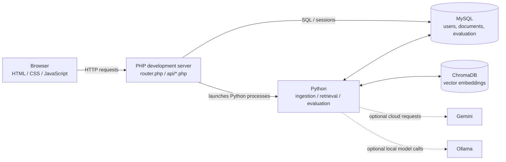

# RAG EVAL 2.0 — Setup and Troubleshooting Guide

**Audience:** students, contributors, and local application operators  
**Scope:** a local development installation of the RAG EVAL 2.0 repository; **not** an Internet-facing production deployment guide  

> **Start here:** If you want the shortest path, follow [Quick setup](#quick-setup), then [First-run verification](#first-run-verification). Consult [Troubleshooting](#troubleshooting) if a step fails. Do not initialize or re-ingest an existing research database without a backup.

## Contents

- [What runs locally](#what-runs-locally)
- [Prerequisites](#prerequisites)
- [Quick setup](#quick-setup)
- [First-run verification](#first-run-verification)
- [Configuration reference](#configuration-reference)
- [Optional AI providers and multimodal extraction](#optional-ai-providers-and-multimodal-extraction)
- [Working with an existing database](#working-with-an-existing-database)
- [Development checks and tests](#development-checks-and-tests)
- [Troubleshooting](#troubleshooting)
- [Security and responsible operation](#security-and-responsible-operation)
- [Implementation references](#implementation-references)

## What runs locally



- **Browser:** the application interface and JavaScript request handling.
- **PHP:** serves the web app, handles accounts and requests, validates inputs, and starts Python-backed tasks (with `proc_open`).
- **Python:** extracts and indexes documents, retrieves evidence, generates answers, and evaluates saved responses.
- **MySQL:** structured application records and keyword-retrievable chunks.
- **ChromaDB:** local vector embeddings and similarity retrieval.
- **Gemini/Ollama (optional):** AI generation or visual extraction; configure providers and models separately.

**Terminology:** a *virtual environment* (`.venv`) isolates Python dependencies. An *embedding* is a numerical representation of document content used for semantic search. An *API endpoint* is a URL, such as `/api/health.php`, through which the browser or another program communicates with the backend.

## Prerequisites

| Component | Expected environment | Verify |
| --- | --- | --- |
| Git | Available to clone the repository | `git --version` |
| Python | 3.11+ recommended by the project README | `python --version` or `py -3.11 --version` |
| PHP | 8.3+ recommended; extensions `pdo_mysql` and `fileinfo` | `php -v`; `php -m` |
| MySQL | 8.x server, initialized and accessible | `mysql --version` and a successful connection |
| Network | Needed for first package and embedding-model downloads | Check package/model download access |
| Optional AI | Gemini credentials **or** Ollama server and installed model | Provider-specific checks below |

**Windows-specific note:** `api/ask.php` and other Python-backed PHP endpoints default to `.venv/Scripts/python.exe`. On macOS/Linux, set `PYTHON_BIN` to the **absolute path** of `.venv/bin/python` in your local `.env`. Don't assume the Windows default works on other operating systems.

## Quick setup

Run all commands from the repository root (the folder containing `router.php`).

### 1. Clone the repository

```bash
git clone https://github.com/sjasthi/llm-rag-evals.git
cd llm-rag-evals
```

If already cloned, open a terminal in its root. Existing installs should use the backup guidance before updating data.

### 2. Create a Python environment and install dependencies

**Windows PowerShell**

```powershell
py -3.11 -m venv .venv
.\.venv\Scripts\python.exe -m pip install --upgrade pip
.\.venv\Scripts\python.exe -m pip install -r rag\requirements.txt
Copy-Item .env.example .env
```

**macOS / Linux**

```bash
python3 -m venv .venv
./.venv/bin/python -m pip install --upgrade pip
./.venv/bin/python -m pip install -r rag/requirements.txt
cp .env.example .env
```

The relevant dependencies are declared in [`rag/requirements.txt`](../../rag/requirements.txt). First setup may download a local embedding model when ingestion or retrieval first runs. Do not assume model files are bundled in Git.

### 3. Configure `.env`

Open your local `.env` file and configure the database connection:

```dotenv
DB_HOST=127.0.0.1
DB_PORT=3306
DB_NAME=llm_rag_evals
DB_USER=root
DB_PASSWORD=replace_with_your_actual_local_password

CHROMA_PATH=rag/chroma
CHROMA_COLLECTION=metrostate_documents

ALLOW_PAID_GENERATION=0
ALLOW_PAID_EVALUATION=0
```

For **macOS/Linux**, also supply the full absolute Python path, for example:

```dotenv
PYTHON_BIN=/absolute/path/to/llm-rag-evals/.venv/bin/python
```

Choose a MySQL user with appropriate privileges for this *local* schema. A dedicated account is preferable to using `root` beyond initial development. The `.env` file is ignored by Git; **never commit credentials**.

### 4. Start MySQL

Start the installed MySQL service using the method appropriate for your operating system. Verify you can connect with the credentials from `.env`.

**Optional Windows helper for an already initialized local runtime:**

```powershell
.\scripts\start-local-mysql.ps1
```

This script assumes a configured `mysqld.exe` location and an existing data directory under its runtime root. **It does not install MySQL, create a data directory, or initialize a new database.** If your installation is elsewhere, start its normal Windows service instead, or pass supported script parameters (see [`scripts/start-local-mysql.ps1`](../../scripts/start-local-mysql.ps1)).

### 5. Initialize the application schema and source corpus

**Only on a new or disposable/local development database**, run:

**Windows PowerShell**

```powershell
.\.venv\Scripts\python.exe rag\ingest.py --init-schema
.\.venv\Scripts\python.exe rag\evaluation.py --seed --json
```

**macOS / Linux**

```bash
./.venv/bin/python rag/ingest.py --init-schema
./.venv/bin/python rag/evaluation.py --seed --json
```

- `ingest.py --init-schema` creates/updates schema structures and ingests the bundled Metro State documents into MySQL and ChromaDB.
- `evaluation.py --seed --json` imports the versioned Gold Standard questions and evaluator definitions.
- Ingestion output reports document/chunk counts and the ChromaDB collection count. These depend on the actual corpus, extraction settings, and environment.

**Do not rerun initialization blindly on an existing study database.** Schema maintenance, indexing, and data changes can affect historical records or the mapping to Chroma vectors. Back up first.

### 6. Start the PHP web server

From the **repository root**:

```bash
php -S 127.0.0.1:8000 -t . router.php
```

Open <http://127.0.0.1:8000/>. The terminal running PHP must remain open. Stop it with `Ctrl+C`. The routing script restricts access to sensitive folders and file types; using `-t . router.php` matters. **Do not replace this with `-t public`** for this repository snapshot.

## First-run verification

Perform these checks in order; stop when one fails.

1. **PHP responds:** Open <http://127.0.0.1:8000/>. You should see the web application rather than a connection error.
2. **MySQL readiness:** Open <http://127.0.0.1:8000/api/health.php>. When the PHP database connection succeeds, the endpoint returns JSON with `"ok": true` and `"status": "ready"`. It returns HTTP **503** if application data cannot be reached. **This is a MySQL readiness check, not a full AI/Chroma/provider health test.**
3. **Account:** Register or sign in. Registration is allowed only when `ALLOW_ACCOUNT_REGISTRATION=1`.
4. **Documents:** Open the Documents view; confirm the indexed corpus appears. An empty list may mean ingestion was not run or failed.
5. **Retrieval without generation:** In Chat, use **Preview Sources** on a question answerable from the indexed corpus. This checks source retrieval without permitting an AI generation call.
6. **Optional generated answer:** Only after intentionally configuring a working provider and generation cost policy, ask a question and inspect its citations.
7. **Evaluation:** Check that seeded Gold Standard questions and evaluators appear. Run small, supported checks before larger experiments.

## Configuration reference

The source of defaults for this snapshot is [`.env.example`](../../.env.example), with additional settings in [`rag/settings.py`](../../rag/settings.py) and PHP configuration helpers.

| Setting | Purpose | Important detail |
| --- | --- | --- |
| `DB_HOST`, `DB_PORT`, `DB_NAME`, `DB_USER`, `DB_PASSWORD` | MySQL connection | PHP and Python must reach the same database. |
| `PYTHON_BIN` | Python executable used by PHP | On Windows, defaults to `.venv/Scripts/python.exe`; use an absolute path on other systems. |
| `CHROMA_PATH`, `CHROMA_COLLECTION` | Local Chroma index | Keep aligned across ingest/retrieval; back up with MySQL. |
| `EMBEDDING_MODEL` | Embedding model | Default `all-MiniLM-L6-v2` in `.env.example`. |
| `CHUNK_SIZE`, `CHUNK_OVERLAP` | Ingestion chunking | Overlap must be nonnegative and smaller than chunk size. |
| `LLM_PROVIDER`, `LLM_CHAT_MODEL`, `LLM_CHAT_MODELS` | Chat model provider and approved model options | Check actual provider support and current model access; examples in `.env.example` are not guarantees of availability. |
| `GEMINI_API_KEY`, `LLM_API_KEY` | Optional Gemini credentials | Use real credentials only in local `.env`. |
| `VLM_PROVIDER`, `VLM_MODEL`, `OLLAMA_BASE_URL` | Visual model extraction | `VLM_*` can be set in `.env` even though they are not listed in this snapshot's `.env.example`. |
| `ALLOW_ACCOUNT_REGISTRATION` | New user registration | `0` prevents self-registration. |
| `ALLOW_PAID_GENERATION`, `ALLOW_UNKNOWN_GENERATION_COST`, `MAX_GENERATION_COST` | Browser answer-generation policy | Generation is off by default; unknown pricing is not assumed free. |
| `ALLOW_PAID_EVALUATION`, `ALLOW_UNKNOWN_EVALUATION_COST`, `MAX_EVALUATION_COST` | Advanced evaluation policy | Keep disabled until explicitly authorized. |
| `MAX_TEST_RUN_RESPONSES`, `MAX_EVALUATOR_APPLICATIONS` | Bounded browser evaluation workload | Defaults in `.env.example` are 5 each. |

**Environment override caveat:** `rag/settings.py` loads `.env` without overriding already-present process environment variables. If changing `.env` seems ineffective, inspect any operating-system environment variables and restart the PHP server.

## Optional AI providers and multimodal extraction

### Gemini

The sample configuration uses `LLM_PROVIDER=gemini`. To use Gemini-backed generation, configure an available model ID and an appropriate API key (`GEMINI_API_KEY`, or `LLM_API_KEY` where applicable). Model identifiers in this repository are deployment examples, not a guarantee that a provider still offers them.

The application intentionally blocks browser generation by default. Do not set `ALLOW_PAID_GENERATION=1` until you understand the model, pricing, budget, and information that will be transmitted externally. The same caution applies to `ALLOW_PAID_EVALUATION=1` for advanced scoring.

### Ollama

The Python generation module supports `LLM_PROVIDER=ollama` and communicates with an Ollama server at `OLLAMA_BASE_URL` (default `http://127.0.0.1:11434`). To use it:

1. Install and start Ollama separately.
2. Download an **appropriate, actually available** model using Ollama's own setup steps.
3. Set `LLM_PROVIDER=ollama`, `LLM_CHAT_MODEL=<installed-model-name>`, and `OLLAMA_BASE_URL` in `.env`.
4. Ensure the configured chat-model options used in the browser match supported models.
5. Test your local provider before concluding that the retrieval or PHP pipeline is broken.

For multimodal *visual extraction*, configure `VLM_PROVIDER=gemini` or `VLM_PROVIDER=ollama`, and `VLM_MODEL` for a supported vision-capable model. A text-only model cannot necessarily extract image evidence. Processing results depend on the image and the selected visual model.

**Security:** external model calls can transmit questions and retrieved content or images. Do not use confidential documents without appropriate permission and controls.

## Working with an existing database

Before migrating, re-ingesting, deleting documents, or changing embedding settings:

1. Stop active application writes and make a MySQL backup.
2. Back up the full directory referenced by `CHROMA_PATH` and record `CHROMA_COLLECTION`.
3. Record the repository revision, `.env` settings **without secrets**, corpus revision, and exact commands used.
4. Test schema migrations and index changes on a disposable copy before touching research records.
5. Verify documents, vector retrieval, saved conversations, and evaluation records after changes.

MySQL and ChromaDB are separate stores: a MySQL database backup **alone** does not preserve local vector embeddings. Similarly, the tracked JSON exports of historical studies do not automatically restore interactive conversation and run history.

## Development checks and tests

These checks help isolate syntax/dependency failures before trying the full browser workflow.

**Windows PowerShell**

```powershell
php -v
php -m
.\.venv\Scripts\python.exe --version
.\.venv\Scripts\python.exe -m pytest tests -v -p no:cacheprovider
node --check assets/js/app.js
php -l index.php
```

**macOS / Linux**

```bash
php -v
php -m
./.venv/bin/python --version
./.venv/bin/python -m pytest tests -v -p no:cacheprovider
node --check assets/js/app.js
php -l index.php
```

`node --check` requires Node.js installed for this optional syntax check; the local PHP app startup does not depend on running that command. Some tests require seeded MySQL/Chroma fixtures or other integrations; distinguish an environment failure from a code failure. See [`.github/workflows/quality.yml`](../../.github/workflows/quality.yml) for automated quality checks and [`tests/`](../../tests/) for individual test coverage.

## Troubleshooting

Start with the **first failing layer** (browser → PHP → MySQL/Python → Chroma/provider) instead of reinstalling everything.

| Symptom | Likely cause | What to check / do |
| --- | --- | --- |
| `php` not recognized | PHP missing or not on PATH | Verify installation and PATH, then reopen the terminal. |
| PHP extension / database driver error | `pdo_mysql` or `fileinfo` not enabled | Run `php -m`; configure extensions for the **CLI PHP** executable used by the development server. |
| Browser cannot reach `127.0.0.1:8000` | PHP server stopped, wrong port or incorrect command | Start `php -S 127.0.0.1:8000 -t . router.php` at the repository root; check terminal for bind errors. |
| `403 Forbidden` for internal paths | Router deliberately blocks sensitive paths | Do not bypass the router. Use supported UI/API routes; `docs/`, `rag/`, `.env`, etc. are not served as files. |
| `/api/health.php` returns 503 | PHP cannot establish MySQL connection | Check MySQL service, `.env` values, DB permissions, and `pdo_mysql`. Review PHP terminal logs. |
| `Access denied for user` | Wrong MySQL username/password or grants | Verify credentials and allowed host with MySQL client; update local `.env`. |
| `Unknown database` / schema error | Schema not initialized, wrong `DB_NAME`, or partial migration | On a **fresh disposable database only**, perform initialization. For existing data, back up and inspect migrations first. |
| `Project Python environment was not found` | PHP cannot find `.venv` interpreter | Check `.venv` and `PYTHON_BIN`; the Windows default is not valid on macOS/Linux. |
| Python reports missing modules | Dependencies installed into another interpreter or incomplete install | Use `.venv` Python explicitly: `python -m pip install -r rag/requirements.txt` with the appropriate path. |
| Documents don't appear | Ingestion failed, wrong database, unsupported source format, or empty corpus | Inspect ingestion terminal output and counts; confirm PHP/Python share the same DB and Chroma paths. |
| Upload rejected | Unsupported extension/MIME or file size | `api/documents.php` enforces compatible file types and a **1 byte–10 MB** upload range. Verify the file and PHP upload configuration. |
| PDF/image ingestion lacks visual evidence | No suitable vision provider/model, missing credentials, failed extraction, or inherently difficult content | Check `VLM_PROVIDER`, `VLM_MODEL`, provider reachability, and extraction results. Successful upload does not guarantee correct image understanding. |
| Preview Sources returns nothing | Chroma not indexed, stale embedding store, incompatible collection, or no matching text | Verify ingestion counts, `CHROMA_PATH`, `CHROMA_COLLECTION`, retrieval mode, and source corpus. |
| Chat says generation is disabled | Default cost safety controls | Leave disabled for retrieval-only use; enable only after deliberate provider/cost configuration. |
| Model not found / unauthorized | Invalid/outdated model ID, missing key, or unavailable provider | Verify exact model access, key, and `LLM_PROVIDER`/`LLM_CHAT_MODEL`. |
| Ollama connection refused | Local Ollama process not running or wrong URL | Start Ollama, confirm `OLLAMA_BASE_URL`, and verify the installed model. |
| Answer generation timed out | Chat Python process exceeded **60 seconds** | Inspect PHP/Python logs, provider latency, model startup, and corpus size. Don't blindly raise limits to mask an underlying failure. |
| Document operation timed out | Document processing exceeded **120 seconds** (bundled restore **300 seconds**) | Inspect source file, extraction/model latency and resource availability; retry only after identifying the cause. |
| Evaluation operation timed out | Certain evaluation endpoints use a **300-second** limit | Reduce run size, check provider readiness and evaluation logs, and inspect the specific endpoint. |
| Login fails / session expired | Incorrect credentials, cookies, session/CSRF token mismatch | Reload page for a fresh session token; sign in again. Check `api/auth.php` behavior. |
| Account registration unavailable | `ALLOW_ACCOUNT_REGISTRATION=0` | Use an existing account or ask the application operator to enable registration. |
| Evaluation shows no reviewed questions | Gold Standard not seeded, or review filters exclude entries | Run the seed command on the intended database and inspect the review status/filter. |
| Some metrics fail or are skipped | Evaluator applicability, reference evidence, dependency or provider requirements | Inspect individual evaluator statuses; a skipped metric does not mean a zero score. |
| `.env` change appears ignored | Running server wasn't restarted, or process env overrides `.env` | Restart PHP; check environment variables already exported in the terminal. |

### Targeted diagnostics

**Check PHP extension loading**

```bash
php -m
```

Look for `PDO`, `pdo_mysql`, and `fileinfo`.

**Confirm which Python installs packages**

```powershell
.\.venv\Scripts\python.exe -m pip --version
.\.venv\Scripts\python.exe -c "import chromadb, mysql.connector; print('Python dependencies OK')"
```

On macOS/Linux replace `.\.venv\Scripts\python.exe` with `./.venv/bin/python`.

**Run ingestion with machine-readable output (only when safe to re-ingest)**

```powershell
.\.venv\Scripts\python.exe rag\ingest.py --json
```

`--json` reports counts; it **still runs ingestion**, and is not a read-only diagnostic. Do not use it on valuable historical data without a backup.

**Inspect browser/API errors**

Open the browser developer tools (usually `F12`) and look at the Network tab for the request status and JSON error message. Also inspect the terminal where PHP is running. Do not copy API keys, session cookies, CSRF tokens, or personal data into public issue reports.

**Understand endpoint-specific timeouts**

- Chat answers: [`api/ask.php`](../../api/ask.php) — `ANSWER_TIMEOUT_SECONDS = 60`.
- Document upload/replace/delete: [`api/documents.php`](../../api/documents.php) — `DOCUMENT_TIMEOUT_SECONDS = 120`.
- Bundled-document restore: same file — `BUNDLED_RESTORE_TIMEOUT_SECONDS = 300`.
- Browser-created test runs: [`api/test_runs.php`](../../api/test_runs.php) — `TEST_RUN_TIMEOUT_SECONDS = 300`.
- Scoring saved runs: [`api/run_evaluation.php`](../../api/run_evaluation.php) — `RUN_EVALUATION_TIMEOUT_SECONDS = 300`.

Time limits apply to specific operations and do not guarantee successful generation within those limits.

## Security and responsible operation

- This is a **local research/development application**; PHP's built-in server is not a production hosting stack.
- Keep `.env`, database passwords, API keys, session tokens, uploads, and private evaluation records out of Git and screenshots.
- The router restricts access to sensitive paths, but is not a substitute for a hardened, reviewed production deployment.
- Uploaded documents and AI-generated content should be treated as untrusted input; verify citations against sources before relying on important claims.
- User-owned conversations and evaluation records are distinct from the **shared** document corpus and Gold Standard data; do not assume every indexed document is private to one account.
- Use explicit opt-in before paid or externally hosted model calls. Zero configured pricing means **unknown**, not necessarily free.
- Back up **both MySQL and ChromaDB** before destructive maintenance or changes to retrieval/index configuration.

## Implementation references

| Area | Code |
| --- | --- |
| Root quick start and feature scope | [`README.md`](../../README.md) |
| Default environment variables | [`.env.example`](../../.env.example) |
| PHP route restrictions | [`router.php`](../../router.php) |
| PHP-to-Python answer execution | [`api/ask.php`](../../api/ask.php) |
| Database readiness endpoint | [`api/health.php`](../../api/health.php) |
| Authentication/session endpoint | [`api/auth.php`](../../api/auth.php) |
| Document operation controls | [`api/documents.php`](../../api/documents.php) |
| Python environment settings | [`rag/settings.py`](../../rag/settings.py) |
| Ingestion/schema initialization | [`rag/ingest.py`](../../rag/ingest.py) |
| Gold Standard/evaluator seeding | [`rag/evaluation.py`](../../rag/evaluation.py) |
| Python dependencies | [`rag/requirements.txt`](../../rag/requirements.txt) |
| Local MySQL helper | [`scripts/start-local-mysql.ps1`](../../scripts/start-local-mysql.ps1) |
| Automated checks | [`tests/`](../../tests/) and [CI workflow](../../.github/workflows/quality.yml) |

For more detail, see the companion [System Architecture](RAG_EVAL_2_0_System_Architecture.md), [Database Schema](RAG_EVAL_2_0_Database_Schema.md), and [Evaluation Methodology](RAG_EVAL_2_0_Evaluation_Methodology.md) documents.
