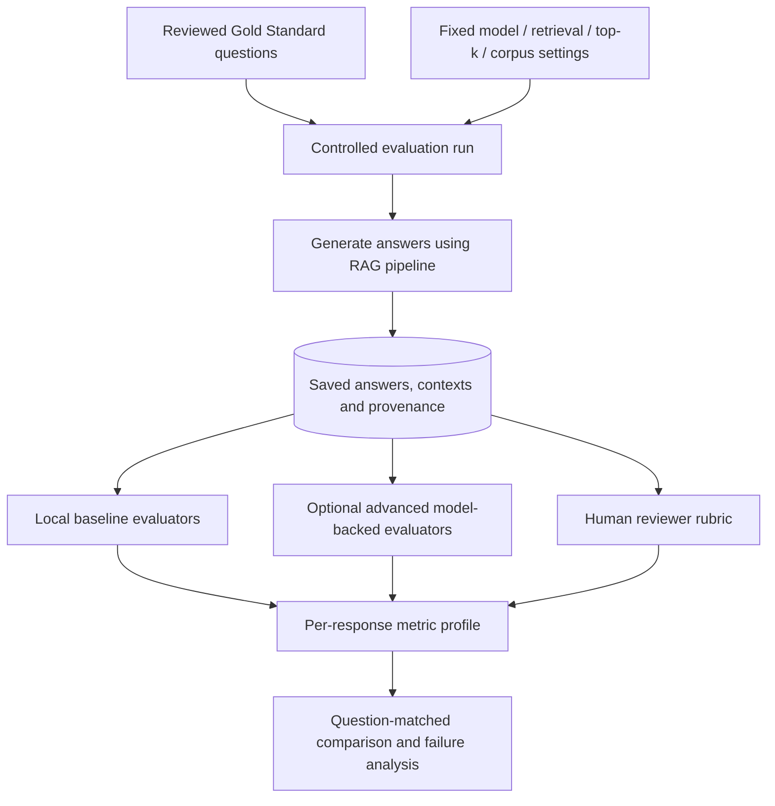

# RAG EVAL 2.0 — Evaluation Methodology

**Project:** RAG EVAL 2.0 (ICS 499 capstone)  
**Document type:** Implementation-grounded methodology and research guide
**Scope:** Evaluation methods and workflows implemented in the supplied repository; historical V1 study evidence is explicitly separated.

> **Research question:** What is the best way to evaluate a Retrieval-Augmented Generation (RAG) response?
>
> **Working conclusion:** No single score proves that a RAG answer is correct, complete, relevant, and supported. This project evaluates saved responses through complementary retrieval, generation, grounding, citation, and human-review signals.

## Contents

- [Evaluation at a glance](#evaluation-at-a-glance)
- [Core terms](#core-terms)
- [Gold Standard question set](#gold-standard-question-set)
- [Evaluator inventory](#evaluator-inventory)
- [Scoring and interpretation](#scoring-and-interpretation)
- [Experimental workflow](#experimental-workflow)
- [Human review and calibration](#human-review-and-calibration)
- [Reproducibility and data storage](#reproducibility-and-data-storage)
- [Cost controls and applicability](#cost-controls-and-applicability)
- [Research evidence and limitations](#research-evidence-and-limitations)
- [Implementation references](#implementation-references)

## Evaluation at a glance

Evaluation operates on **saved responses**, not merely on text displayed in Chat. A controlled test run first generates one answer for each selected reviewed question and persists the question snapshot, configuration, response, and ordered retrieval evidence. Compatible evaluators then independently score that **same saved answer**. This isolates disagreement between evaluators from differences caused by regenerating the answer.

Evaluation dimensions must remain distinct:

| Dimension | Question being answered | Typical evidence |
| --- | --- | --- |
| **Retrieval** | Did the system find and rank the right source material? | Expected-source hit/rank, context precision and recall |
| **Answer correctness/completeness** | Did the response communicate the reviewed facts accurately and fully? | Exact/fact/token metrics, judge rubric, human review |
| **Grounding / faithfulness** | Are the response's claims supported by retrieved material? | RAGAS Faithfulness, citation support, human evidence check |
| **Relevance** | Does the response address the user's question? | Response relevancy, rubric relevance |
| **Citation integrity** | Are citations present, valid, sufficiently distributed, and supported? | Presence, ID validity, citation coverage/support |
| **Operational quality** | Was execution reliable and appropriately bounded? | Latency, cost estimates, errors, failure status |

## Core terms

- **RAG (Retrieval-Augmented Generation):** Retrieve relevant material before asking a language model to draft an answer from it.
- **Gold Standard:** A manually reviewed set of questions and reference information against which saved answers are compared.
- **Retrieved context:** Text or other extracted evidence returned by the search system for a question; stored with rank and provenance.
- **Evaluator:** A program or reviewer that examines a saved response for one specific quality dimension.
- **LLM-as-judge:** An AI model applying a defined assessment rubric rather than answering the user's original question.
- **RAGAS:** A framework implementing retrieval and generation evaluation metrics.
- **Top-k:** Number of final retrieved chunks supplied to answer generation.
- **Threshold:** A project-defined review cutoff. It is **not** a validated probability of correctness.
- **Not applicable / skipped:** A metric lacks meaningful inputs or does not fit a case; this is not a zero score.

## Gold Standard question set

The versioned dataset [`data/evaluation/metrostate_v2.json`](../../data/evaluation/metrostate_v2.json) contains **50 reviewed questions** (`version: 2.0`). It provides the reference material needed for controlled evaluation. The earlier V1 dataset remains separate for historical reproducibility.

Question records and/or database snapshots capture relevant fields such as the question, reviewed answer, expected source/evidence, accepted answers, required facts, answerability label, category, difficulty, review status, and question identity. These are not interchangeable:

- **Reference answer:** An expected response, not necessarily the only acceptable wording.
- **Accepted answers:** Reviewed alternative phrasings used by some lexical checks.
- **Required facts:** Specific information that a complete response must include.
- **Expected source/evidence:** Reviewed grounding used to evaluate retrieval and support.
- **Answerability:** Distinguishes questions supported by the corpus from deliberately unanswerable cases where refusal is expected.

Only active, reviewed questions are selected for controlled runs. The run stores a **snapshot** of the review fields so subsequent editing of the Gold Standard does not silently rewrite the historical basis for a saved response. Dataset review is a prerequisite to interpreting metric results; an incorrect reference answer can make a correct generated answer appear wrong.

## Evaluator inventory

**Important inventory note:** The current `rag/evaluator_catalog.py` defines **17 automated evaluator definitions: 10 local baseline and 7 advanced**. Five advanced evaluators are in the default advanced selection; **Citation Coverage and Citation Support are opt-in**. Older README/research descriptions of **13** evaluators refer to an earlier catalog and do not match this snapshot. Human review is a separate mechanism and is **not** counted as an automated evaluator.

### A. Local baseline evaluators (10)

Local means no paid evaluator-model API call is needed; some metrics still require locally installed ML models and computation.

| Evaluator key | What it measures | Reported score / calculation | Main limitation |
| --- | --- | --- | --- |
| `exact_contains` | Match to reviewed answer or accepted wording | `1.0` exact; `0.75` containment; otherwise `0` | Wording match is not factual proof; paraphrases can fail. |
| `required_fact_coverage` | Reviewed fact phrases present in answer | Matching required facts ÷ all required facts | Literal presence may be misleading; no facts ⇒ not applicable. |
| `token_f1` | Word overlap against best accepted reference | Unigram precision/recall F1 | Penalizes paraphrases; cannot verify truth. |
| `rouge_l` | Ordered word overlap | Longest-common-subsequence F1 | Shared order is not evidence of correctness. |
| `semantic_similarity` | Overall meaning similarity | Cosine similarity of `all-MiniLM-L6-v2` answer/reference embeddings | May miss wrong dates, numbers, or negations. |
| `bertscore` | Contextual token similarity | BERTScore F1 using `distilbert-base-uncased` | Not a probability of factual correctness. |
| `expected_source_accuracy` | Whether reviewed source occurs in retrieved top-k | Binary source hit with retained rank | A correct document hit may still contain inadequate evidence. |
| `refusal_correctness` | Agreement with reviewed answerability | Binary expected-refusal behavior match | Does not assess substantive quality of answerable responses. |
| `citation_validity` | Whether cited IDs correspond to saved retrieved evidence | Valid unique citation IDs ÷ unique cited IDs | Valid IDs do not establish that sources support claims. |
| `citation_presence` | Whether a non-refusal response has a citation | Binary citation presence | Presence does not guarantee valid or relevant evidence. |

The first eight metrics cover the principal lexical, semantic, retrieval, and refusal checks; the two citation checks add mechanical citation integrity. The current default local test-run list includes all ten (`rag/run_evaluation.py`).

### B. Advanced evaluators (7)

These use model-backed interpretation and may incur provider costs. They are not guaranteed to be deterministic between executions.

| Evaluator key | What it evaluates | Method / output | Selection |
| --- | --- | --- | --- |
| `llm_judge` | Correctness, completeness, faithfulness, relevance, and refusal | Versioned 0–4 rubric per applicable dimension; normalized mean and explanations | Default advanced |
| `ragas_faithfulness` | Support of answer claims by retrieved contexts | RAGAS supported-claim proportion | Default advanced |
| `ragas_response_relevancy` | Whether the answer addresses the question | RAGAS response relevancy using generated questions and embedding similarity | Default advanced |
| `ragas_context_precision` | Ranking useful contexts before distractors | RAGAS context precision | Default advanced |
| `ragas_context_recall` | Retrieved support for reviewed reference claims | RAGAS context recall | Default advanced |
| `citation_coverage` | How many identified factual claims carry valid saved citations | Citation-bearing claims ÷ identified factual claims | **Opt-in** |
| `citation_support` | Whether claims in cited statements are supported by their specific cited sources | Supported assessable claims ÷ assessable claims; separate assessment coverage | **Opt-in** |

The two advanced citation evaluators are implemented in `rag/advanced_evaluation.py` and are not included in `DEFAULT_ADVANCED_EVALUATOR_KEYS` in `rag/run_advanced_evaluation.py`. They must be explicitly selected; their existence does **not** mean the default advanced workflow always runs them.

**Model-backed assessment caveat:** These evaluators use the reviewed information and/or saved contexts, but can misinterpret claims, introduce judge bias, and consume API tokens. Citation Coverage, Citation Support, and RAGAS Faithfulness answer **different** questions and should not be treated as equivalent.

### C. Human review (separate from automated counts)

Human reviewers assign 1–5 scores where applicable for correctness, completeness, faithfulness, relevance, and refusal correctness. They also record an overall decision (`acceptable`, `needs_revision`, `incorrect`, or `not_applicable`), optional failure category, notes, reviewer alias, and rubric version. The current-review flag preserves the distinction between superseded and current reviews.

Unlike the automated judge's 0–4 scale, the **human review fields use 1–5**. Do not combine them without explicitly stating a transformation and its assumptions.

## Scoring and interpretation

### A profile, not a universal grade

Each metric answers a narrow question; the application should be interpreted as a **per-response profile** rather than a single combined accuracy percentage. Examples:

- A response may find the correct source (`expected_source_accuracy = 1`) and still omit a required fact.
- High semantic similarity can coexist with an incorrect registration date.
- A valid citation ID can point to a passage that does not support the adjacent claim.
- A relevant response can be unsupported; a faithful response can be incomplete.

### Thresholds and status

The evaluator catalog stores descriptive thresholds for selected methods; for example, token F1 `0.70`, semantic similarity `0.75`, BERTScore `0.80`, and LLM judge `0.75`. These are **project-defined, unvalidated review thresholds**, not universal success criteria. RAGAS evaluators in this snapshot do not define a catalog threshold. Avoid statements such as “0.90 means the response is 90% correct.”

Evaluations can be `completed`, `skipped`, or `failed`; a skip (for example, missing reviewed facts or an inapplicable unanswerable-case metric) must not become zero in analysis. Report the **number of applicable, completed measurements** alongside aggregates and describe failures separately.

### Advanced rubric scoring

The LLM judge uses the following scale for each applicable dimension:

| Rating | Meaning |
| --- | --- |
| 0 | Wholly unacceptable or contradicted |
| 1 | Major problems |
| 2 | Mixed or partial quality |
| 3 | Good with a minor issue |
| 4 | Fully satisfies the dimension |

Its normalized summary excludes genuinely inapplicable dimensions. The judge receives the question, reference, answerability label, required facts, saved contexts, and generated response. It is a **judgment about saved evidence**, not a second generation of the original answer.

## Experimental workflow

1. **Prepare and review the dataset.** Verify expected facts, source evidence, answerability, and alternate accepted wordings; select active reviewed questions.
2. **Freeze the configuration.** Fix retrieval method (`chroma_vector`, `mysql_keyword`, or `hybrid_rrf`), `top_k`, model, generation settings, and corpus variant/category filter. Record a run name and identifiers.
3. **Preflight before execution.** Verify selected questions and response limits; assess paid-generation permissions, model availability, estimated cost, and unknown-cost policy. A dry run can inspect configuration without creating model-backed answers.
4. **Generate and persist responses.** The Python test-run path calls the shared answer pipeline and writes one response/context set per question, together with question snapshots and run provenance.
5. **Apply baseline checks to saved responses.** Compute the default ten local evaluators when their inputs apply; persist scores, explanations, runtime, and status.
6. **Optionally apply advanced checks.** Reuse the **same saved answers and contexts**. Choose the five standard advanced checks or explicitly select citation claim evaluators. Preflight and record costs, skips, repeats, and failures.
7. **Perform sampled human review.** Compare human judgments with lexical, semantic, retrieval, grounding, and citation signals; investigate contradictions and borderline results.
8. **Compare controlled runs.** Match the **same reviewed question IDs and ordering** and change one relevant factor at a time. Compare response-level outputs and metric profiles, not just overall averages.
9. **Report evidence and limitations.** Include experimental settings, question sample, eligible metric counts, error/skip rates, latency and cost, disagreements, and illustrative failures.

### Controlled-comparison design

A defensible comparison changes **one factor at a time**, for example:

| Baseline | Variant | Interpretation |
| --- | --- | --- |
| Chroma vector search, top-k 3 | MySQL keyword search, top-k 3 | Retrieval-method effect, holding other settings fixed |
| Chroma vector search, top-k 3 | Chroma vector search, top-k 5 | Context-size / top-k effect |
| Model A, fixed retrieval and corpus | Model B, identical settings | Model-selection effect |
| Full corpus | Reviewed subset of corpus | Corpus-selection effect, if other factors and question IDs are held fixed |

Not all such comparisons are necessarily present in the current live database. **Historical results** are documented separately below.

## Human review and calibration

Human review is the mechanism for checking whether automatic metrics agree with a knowledgeable reader, especially for paraphrases, numerical details, unanswerable questions, unsupported claims, and incomplete responses.

Recommended review procedure consistent with the implemented fields:

1. Inspect the frozen question, reviewed answer, required facts, and expected evidence.
2. Read the saved answer **and the actual retrieved contexts**; do not treat an attached citation as proof of support.
3. Score correctness, completeness, faithfulness, relevance, and refusal behavior when applicable (1–5), recording an overall decision and notes.
4. Compare the human decision with automated results; explain disagreements rather than averaging unlike measures into one number.
5. Preserve the reviewer/version and current versus superseded review status for auditability.

Human review is not an infallible oracle: rubric consistency, reviewer expertise, sample size, and disagreement handling affect reliability. The provided repository does **not** demonstrate statistically validated thresholds or broad inter-rater reliability estimates.

## Reproducibility and data storage

The system records data in MySQL tables including:

| Table | Research role |
| --- | --- |
| `evaluation_datasets`, `evaluation_questions`, `evaluation_question_memberships` | Versioned question bank and dataset membership |
| `model_settings`, `evaluation_runs` | Run configuration and execution history |
| `rag_responses` | Saved model answers, timing and run linkage |
| `retrieved_contexts` | Ordered retrieved evidence and ranking/provenance |
| `evaluator_definitions` | Evaluator identity, version, and score contracts |
| `evaluator_results`, `evaluator_attempts` | Current/canonical results plus attempts and failures |
| `human_reviews` | Human rubric, decisions, notes, reviewer and current status |

See [V2 Database Schema](RAG_EVAL_2_0_Database_Schema.md) and the authoritative [`database/schema.sql`](../../database/schema.sql) for structural details. The application also distinguishes owner-scoped run/response history from shared Gold Standard and document resources.

**Reproducibility checklist:** Capture dataset version/question IDs, frozen reference snapshots, ordered retrieved contexts, corpus and retrieval method, model/settings, evaluator key/version, threshold interpretation, execution timestamps, statuses, error messages, estimated costs, and human-review decisions. Providers and their model availability can change over time, so record the deployed model and environment rather than assuming a model name is timeless.

## Cost controls and applicability

- **Local evaluators** do not require paid evaluator API calls, although semantic/BERTScore checks require local model resources.
- **Advanced evaluators** may use external models; enable model-backed evaluation only after reviewing API credentials and explicit paid/unknown-cost allowances.
- **Preflight** estimates applications and cost when configured; unknown cost is not treated as free.
- **Repeat advanced evaluations** may be useful for measuring model variability, but they must be treated as distinct attempts, not independent ground-truth samples.
- **Applicability checks** prevent meaningless scores: e.g., context precision/recall require an answerable question, reviewed reference, and contexts; faithfulness is uninformative for an exact claim-free refusal; citation support requires cited statements.
- **Reuse** of completed or not-applicable evaluator results avoids unnecessary recomputation unless a forced rerun is requested.
- **Evaluation timeouts or provider failures** are operational outcomes, not proof the generated answer was incorrect.

## Research evidence and limitations

### Historical V1 study evidence — do not relabel as V2 outcomes

The repository retains a [historical final study report](../V1%20docs/final-study-report.md) and [six portable final-study JSON exports](../../data/evaluation/final-study/README.md). These describe a **V1-era controlled study**, not a completed new V2 multimodal effectiveness study. The historical conditions used five common reviewed question IDs and tested retrieval, top-k, model, and corpus changes. The recorded human review sample contained **seven reviewed responses**, with **six acceptable** and **one requiring revision**. Those observations are useful as methodology examples but are too small to establish global superiority of one evaluation method.

The historical report demonstrates why a metric portfolio matters: a correct paraphrase may fail exact matching, a correct retrieved source may still produce an incomplete answer, and an apparently strong relevance score is not a factual-correctness probability.

### What this document does *not* claim

- It does **not** claim that the V2 evaluator framework has completed a full controlled multimodal effectiveness study using all 50 questions.
- It does **not** claim that all 17 cataloged evaluators execute on every response or that opt-in citation checks are run by default.
- It does **not** claim review thresholds are empirically calibrated, or that one metric measures overall answer quality.
- It does **not** treat a source match, citation presence, or semantic similarity as proof of factual grounding.
- It does **not** infer live database state or successful API execution merely from repository source code.

**Open research work (not documented as completed results):** Broader V2 multimodal sampling; human-reviewed comparison across document types and retrieval conditions; inter-rater agreement; threshold calibration; provider and cost sensitivity; and repeated-run variability analysis. These are natural next studies, not established outcomes.

## Implementation references

The following paths are relative to the repository root:

| File | Purpose |
| --- | --- |
| [`rag/evaluator_catalog.py`](../../rag/evaluator_catalog.py) | Authoritative evaluator names, versions, input contracts, calculation summaries, thresholds, and limitations |
| [`rag/evaluation.py`](../../rag/evaluation.py) | Local evaluator implementations, Gold Standard import/validation, scoring of saved answers |
| [`rag/advanced_evaluation.py`](../../rag/advanced_evaluation.py) | Judge rubric, RAGAS, citation coverage/support, applicability |
| [`rag/run_evaluation.py`](../../rag/run_evaluation.py) | Controlled answer generation and local evaluation |
| [`rag/run_advanced_evaluation.py`](../../rag/run_advanced_evaluation.py) | Advanced selection, cost preflight, saved-response evaluation |
| [`rag/evaluate_saved_run.py`](../../rag/evaluate_saved_run.py) | Reapply evaluators to a saved run |
| [`rag/evaluation_store.py`](../../rag/evaluation_store.py) | Persist and reuse evaluator results and attempts |
| [`api/evaluations.php`](../../api/evaluations.php) | Browser evaluation views and human-review operations |
| [`data/evaluation/metrostate_v2.json`](../../data/evaluation/metrostate_v2.json) | Reviewed 50-question V2 Gold Standard source |
| [`docs/V1 docs/evaluation-strategy.md`](../V1%20docs/evaluation-strategy.md) | Historical evaluation planning and research framing |

---

**Maintenance note:** When an evaluator is added or its score calculation changes, update this document together with `rag/evaluator_catalog.py`; verify active evaluator selections separately from the catalog inventory. Keep historical V1 evidence explicitly labeled as historical.
