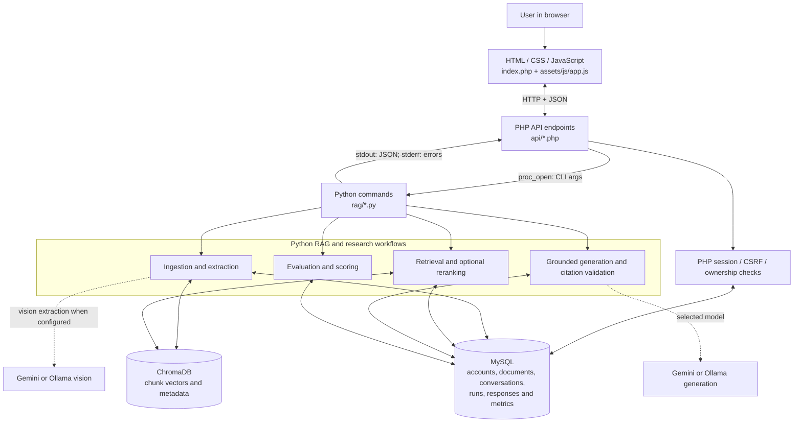
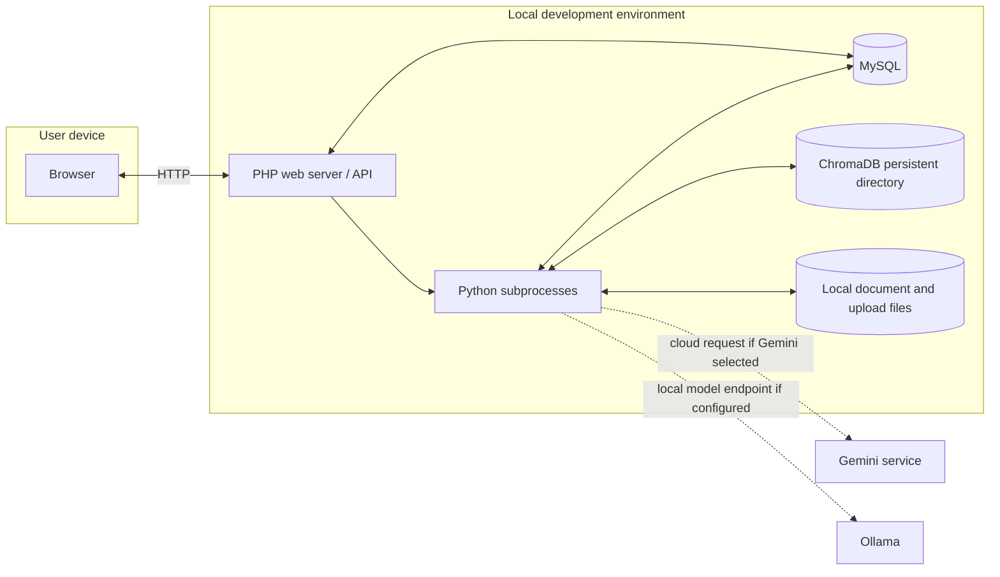
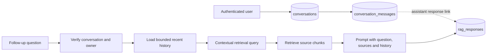
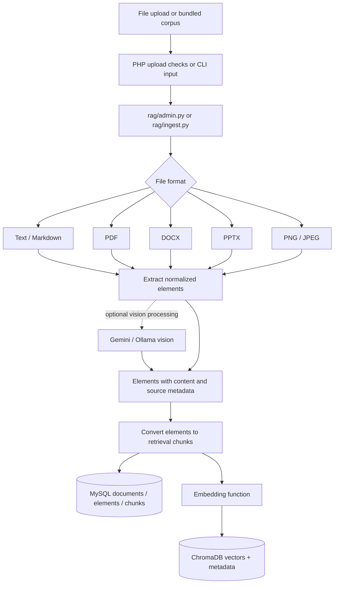
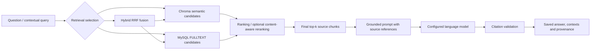
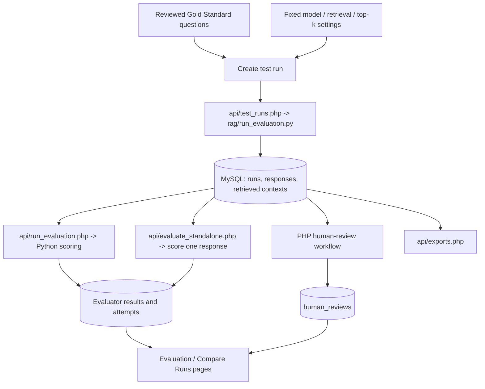
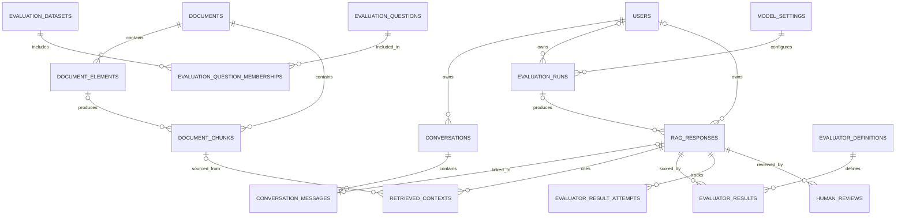

# RAG EVAL 2.0 — System Architecture

**Project:** RAG EVAL 2.0 · ICS 499 Capstone  
**Document type:** Implementation-grounded system architecture reference
**Scope:** Implemented local application, its interfaces and major runtime workflows. This document describes the repository, not a verified production deployment.

> **At a glance:** A browser-based interface sends requests to a PHP backend. PHP handles web-facing validation, sessions, authorization, and coordination, and uses separate Python processes for document ingestion, retrieval, answer generation, and evaluation. MySQL persists structured application and research data; ChromaDB persists searchable embedding vectors. Gemini and/or locally configured Ollama provide optional model capabilities.

## Contents

- [Architecture at a glance](#architecture-at-a-glance)
- [Key terms](#key-terms)
- [Component responsibilities](#component-responsibilities)
- [Deployment and trust boundaries](#deployment-and-trust-boundaries)
- [Chat: end-to-end request sequence](#chat-end-to-end-request-sequence)
- [Conversation memory and account ownership](#conversation-memory-and-account-ownership)
- [Multimodal document ingestion](#multimodal-document-ingestion)
- [Retrieval and grounded answer generation](#retrieval-and-grounded-answer-generation)
- [Evaluation and research workflows](#evaluation-and-research-workflows)
- [Data architecture](#data-architecture)
- [Security and cost controls](#security-and-cost-controls)
- [Operational behavior and failure modes](#operational-behavior-and-failure-modes)
- [Source code map](#source-code-map)
- [Architecture constraints and future considerations](#architecture-constraints-and-future-considerations)

## Architecture at a glance



**Diagram interpretation:** Arrows show major dependencies and logical information flows. They do not imply a single persistent Python service, queue, remote microservice, or separate deployment for each module. PHP starts Python command-line programs as needed.

## Key terms

| Term | Meaning in this project |
| --- | --- |
| **Frontend** | The browser-facing pages and JavaScript with which a person interacts. |
| **Backend** | Server-side logic that receives requests and accesses application services or storage. |
| **API endpoint** | A PHP URL such as `api/ask.php` that accepts an HTTP request and returns a structured response. |
| **HTTP / JSON** | HTTP carries browser/server requests; JSON is the structured text format used for many responses and commands. |
| **CLI** | Command-line interface: Python scripts started with flags such as `--top-k` and `--json`. |
| **Process** | A running instance of a program. `proc_open()` starts a separate Python process from PHP. |
| **RAG** | Retrieval-Augmented Generation: retrieve relevant source material before asking an AI model to answer. |
| **Chunk** | A searchable piece of an extracted document, accompanied by source information. |
| **Embedding** | A numeric representation that supports similarity search. |
| **Provenance** | Evidence of where data or a response came from: source, element, chunk, rank, model, or configuration. |
| **CSRF token** | A per-session security value used to reject unauthorized state-changing browser requests. |

## Component responsibilities

| Layer | Key files / systems | Actual responsibility |
| --- | --- | --- |
| **Presentation** | `index.php`, `assets/js/app.js`, CSS, `includes/` | Display pages, accept questions/uploads, submit requests, and render answers, sources, conversations, runs, and comparisons. |
| **Web backend and APIs** | `api/*.php` | Validate incoming requests, enforce authentication and ownership, read/write appropriate MySQL records, invoke Python workflows, and return JSON/exports. |
| **Authentication** | `api/auth.php`, `includes/auth.php` | Registration/sign-in, password verification, PHP session lifecycle, and CSRF token checks. |
| **Python orchestration/commands** | `rag/answer.py`, `rag/admin.py`, `rag/run_evaluation.py`, `rag/evaluate_saved_run.py` | Implement domain workflows that PHP invokes through a local Python executable. |
| **Document processing** | `rag/ingest.py`, format processors, `rag/chunking.py`, `rag/visual_processor.py`, `rag/vlm_providers/` | Extract documents and visual descriptions, create structured elements and chunks, retain extraction metadata. |
| **Retrieval** | `rag/query.py`, `rag/content_reranker.py`, `rag/vector_store.py` | Search MySQL and/or ChromaDB; merge and optionally rerank candidate evidence. |
| **Answer generation** | `rag/answer.py`, `rag/llm.py`, `rag/citation_validator.py`, `rag/conversation.py` | Construct grounded prompts, use a configured generation model, check citations, and persist responses and conversation exchanges. |
| **Evaluation** | `rag/evaluation.py`, `rag/evaluator_catalog.py`, `rag/advanced_evaluation.py`, `rag/run_advanced_evaluation.py`, `rag/evaluation_store.py` | Manage reviewed question data, controlled runs, metric definitions, scoring, and saved evidence. |
| **Relational persistence** | MySQL, `database/schema.sql`, `database/migrations/`, `rag/database.py`, `config/database.php` | Persist users, document structure, conversations, evaluation runs, answer evidence, and review results. |
| **Vector persistence** | ChromaDB, `rag/vector_store.py` | Maintain the local vector collection and its chunk metadata for semantic search. |
| **External/local models** | Gemini, Ollama | Provide selected generation or optional visual extraction; availability depends on configuration and installed model/service. |

### PHP and Python: an intentional division

PHP is **not** the RAG inference engine. It accepts a web request, checks whether it is allowed, assembles a Python command, and reads the result. In `api/ask.php`, `proc_open()` launches `rag/answer.py` and the PHP endpoint decodes Python's JSON output. Python carries out retrieval and generation, then reports the answer and metadata back. Some PHP endpoints also query MySQL directly to display or update application records without running Python.

## Deployment and trust boundaries

The documented workflow is **local development**, started from the repository root:

```bash
php -S 127.0.0.1:8000 -t . router.php
```

The browser reaches the locally hosted PHP server. The PHP application executes Python from a configured `PYTHON_BIN` (defaulting on Windows to `.venv/Scripts/python.exe`). Python connects to MySQL/ChromaDB and, if selected, the model provider. `router.php` denies direct web requests to sensitive repository directories (for example `database`, `rag`, `storage`, `config`, and `docs`) and selected file extensions.



This diagram is a *logical deployment view*: MySQL is a running database service; ChromaDB is accessed through a persistent local Python client. This is not a claim that a standalone Chroma server is deployed. The built-in PHP server is for development, **not** a hardened public deployment.

## Chat: end-to-end request sequence

The normal Chat flow originates in `assets/js/app.js`, calls `api/ask.php`, and runs `rag/answer.py`. The browser can ask for **answer** or **preview**; preview retrieves sources without generating a model answer.

```mermaid
sequenceDiagram
    autonumber
    actor User
    participant JS as Browser / app.js
    participant PHP as api/ask.php
    participant Auth as Session + CSRF checks
    participant PY as rag/answer.py
    participant Stores as MySQL + ChromaDB
    participant Model as Configured LLM
    User->>JS: Submit question
    JS->>PHP: POST JSON (question, action, model, retrieval, top_k, conversation_id)
    PHP->>Auth: Validate request and identity when required
    Auth-->>PHP: Authorized / rejected
    alt Authorized
        PHP->>PY: proc_open(command + arguments, --json)
        PY->>Stores: Verify conversation ownership and/or retrieve evidence
        Stores-->>PY: History and ranked source chunks
        alt action = answer
            PY->>Model: Grounded prompt with sources and history
            Model-->>PY: Generated answer
            PY->>Stores: Save answer, provenance and conversation exchange
        else action = preview
            Note over PY: Retrieval-only dry run; no generated answer
        end
        PY-->>PHP: JSON on stdout (or error on stderr)
        PHP-->>JS: JSON response
        JS-->>User: Render answer/sources or preview/error
    end
```

### Concrete handoff in the code

The JavaScript calls the PHP API with an AJAX `POST` (`assets/js/app.js`, `requestChat()`). PHP uses an argument array that begins with the Python executable, `rag/answer.py`, the question, and selected flags; it adds `--user-id`, `--conversation-id` or `--new-conversation`, and `--dry-run` when applicable. A simplified illustration of the real handoff is:

```php
$command = [$python, $root . '/rag/answer.py', $question,
    '--model', $model, '--top-k', (string) $topK,
    '--retrieval', $retrievalMethod, '--json'];
$process = proc_open($command, $descriptors, $pipes, $root, null,
    ['bypass_shell' => true]);
```

*Illustrative excerpt:* the actual endpoint also supplies temperature/top-p, cost bounds, user/conversation context, and validation. It reads `stdout` and `stderr`, checks completion and result structure, and returns `{'ok': true, 'data': ...}` as JSON. It has an **answer timeout of 60 seconds**. PHP calls `session_write_close()` before long-running generation so the session lock is not held throughout the work.

### Preview versus answer

- **Preview Sources:** Executes retrieval with `--dry-run`; does not require paid generation. An unauthenticated user can preview without a saved conversation; previewing *within* an existing conversation requires authentication and ownership.
- **Answer:** Requires a signed-in user and valid CSRF token, checks the local generation opt-in setting, generates an answer, validates its citation references, and attempts to save the response and associated exchange.
- **Response handling:** `showAnswer(...)` renders the returned data; the browser keeps a returned `conversation_id` to support follow-up questions.

## Conversation memory and account ownership



`rag/conversation.py` provides bounded history and contextual query construction. `rag/answer.py` checks that an existing conversation belongs to the passed user before using it. `api/conversations.php` lists and loads only the signed-in user's active conversations and supports archiving. The browser stores the current conversation ID so a subsequent question continues the correct thread.

This is **conversation memory**, not model training or a global user-memory service. Conversation history is stored in MySQL and supplied to later questions within defined bounds. Documents and the Gold Standard are **shared resources**; saved conversations and evaluation results have per-user ownership. The implementation also handles unknown or inaccessible conversations without revealing another user's records.

## Multimodal document ingestion

The supported ingestion pipeline distinguishes a **document element** (text/table/image/diagram-derived unit with provenance) from a **retrieval chunk** (text used for searching). Format-aware processing is implemented for TXT/MD, PDF, DOCX, PPTX, PNG, and JPEG. Visual extraction quality depends on the format and configured provider; merely accepting a file does not guarantee that every visual is interpreted correctly.



**Web ingestion:** `api/documents.php` checks file type/size and invokes `rag/admin.py` through `proc_open()` for ingestion, deletion, or restore operations. **Batch/local ingestion:** `rag/ingest.py` can initialize the schema and ingest the bundled document corpus. The code retains page number, element index, content type, extraction method/model, and source-identification fields where available.

**Consistency note:** MySQL and ChromaDB are separate persistence systems; one is not simply a replica of the other. Upload/delete/reindex operations must coordinate the structured records and corresponding vectors. `rag/vector_store.py` provides document-specific vector replacement/deletion functions with cleanup verification.

## Retrieval and grounded answer generation



The browser-facing choices are `chroma_vector`, `mysql_keyword`, and `hybrid_rrf`:

- **Chroma vector:** Embedding-based candidate retrieval, with lexical reranking logic in `rag/query.py`.
- **MySQL keyword:** MySQL **FULLTEXT** candidate retrieval with additional lexical scoring; the source describes this as a lexical baseline. **Do not assume a BM25 algorithm** solely from a diagram label—the current implementation documents FULLTEXT natural-language scoring plus project reranking.
- **Hybrid RRF:** Combines Chroma and MySQL candidate rankings using Reciprocal Rank Fusion (RRF). RRF combines ranked lists, rather than relying on directly comparable raw scores.

`rag/content_reranker.py` adds optional content-aware ranking. `rag/llm.py` assembles the grounded prompt and uses the configured model/provider. `rag/citation_validator.py` checks inline citations against the retrieved source ranks; this validation **does not independently prove that each factual claim is correct**. `rag/answer.py` records response text, chosen settings, retrieved evidence, timing/token data where available, and generation provenance.

## Evaluation and research workflows

The app distinguishes **generating a controlled set of answers** from **scoring those saved answers**. This matters because generating a new response during scoring could change the evidence being compared.



- `api/test_runs.php` validates the request and starts `rag/run_evaluation.py` to create controlled test runs, with preflight checks and execution limits.
- `api/run_evaluation.php` supports preflight and evaluation of existing saved runs using Python, rather than treating metric computation as equivalent to generating new answers.
- `api/evaluate_standalone.php` provides preflight/execution for a selected saved response.
- `api/evaluations.php` supplies evaluation data and records human reviews; `api/exports.php` provides export workflows.
- `includes/ownership.php` checks that a run/response belongs to the signed-in user before sensitive evaluation actions.

The evaluator catalog in this repository snapshot defines **17 automated evaluators** (10 local, 7 advanced); two advanced citation-claim checks are opt-in. Human review is separate. For the metrics, applicability rules, limitations, and experiment design, consult [Evaluation Methodology](RAG_EVAL_2_0_Evaluation_Methodology.md).

## Data architecture

MySQL stores structured records; ChromaDB stores persistent embedding vectors. The shared identifiers and source metadata allow retrieval results to be associated with their documents and evidence.



*Simplified conceptual diagram.* The schema also contains other tables and relationships, including evaluator scores and migration tracking. **A vector collection is not represented as a MySQL table in this diagram.** `document_chunks.chroma_id` identifies the corresponding Chroma vector record. See [V2 Database Schema](RAG_EVAL_2_0_Database_Schema.md) and [`database/schema.sql`](../../database/schema.sql) for the complete data model and migration behavior.

### Primary data groups

| Data group | MySQL records | Role |
| --- | --- | --- |
| Indexed content | `documents`, `document_elements`, `document_chunks` | Document identity, extracted structure, searchable chunks and provenance. |
| Accounts and chat | `users`, `conversations`, `conversation_messages` | Sign-in identities and user-owned conversation history. |
| Research datasets and runs | `evaluation_questions`, `evaluation_datasets`, `evaluation_question_memberships`, `model_settings`, `evaluation_runs` | Reviewed questions and test configurations. |
| Generated answers and evidence | `rag_responses`, `retrieved_contexts` | Saved answers and retrieval snapshots. |
| Assessment and review | `evaluator_definitions`, `evaluator_results`, `evaluator_result_attempts`, `human_reviews`, `evaluation_scores` | Automated assessment, execution attempts, human judgment and legacy scoring data. |

## Security and cost controls

- **Authentication:** `includes/auth.php` uses PHP sessions, password hashing/verification, and regenerated session identifiers at sign-in. Accounts are managed through `api/auth.php`.
- **CSRF checks:** State-changing browser requests require a session token where enforced. This helps prevent malicious sites from silently issuing actions on behalf of a signed-in user.
- **Ownership checks:** Conversations and saved evaluation records are checked against the current user. Both PHP (`includes/ownership.php` and APIs) and Python conversation handling enforce relevant ownership boundaries.
- **Request validation:** Chat validates question length, model/retrieval settings, and numeric limits; document upload checks file extensions and compatible file information.
- **Development routing:** `router.php` blocks direct access to sensitive directories and file extensions through the development server.
- **Paid-model opt-in:** `ALLOW_PAID_GENERATION` and evaluation-specific configuration default to disabled. Python command-line controls include cost bounds and an explicit flag for unknown-cost generation if enabled.
- **Model privacy boundary:** With Gemini, relevant prompts/content travel to an external model provider; Ollama can provide a local alternative when installed/configured.

These are documented **controls**, not a claim of a completed security audit or production-ready deployment. Avoid committing `.env`, secrets, uploaded private files, or user records.

## Operational behavior and failure modes

| Condition | Expected architectural behavior |
| --- | --- |
| PHP server not running | The browser cannot use the local web application. |
| Python environment missing | PHP cannot start Python-backed endpoints; `api/ask.php` produces an error. |
| MySQL unavailable | Authentication, document metadata, conversations and evaluation functions may fail. |
| Chroma collection unavailable/incomplete | Semantic/hybrid retrieval may fail or produce incomplete evidence. |
| No relevant source chunks | The answer path raises a no-matching-source error rather than producing an ungrounded response through that route. |
| Model provider unavailable or generation disabled | Retrieval-only preview may still work; paid answer generation is blocked or fails gracefully. |
| Python answer exceeds timeout | `api/ask.php` terminates the child process and returns an error response. |
| Invalid/foreign conversation ID | The application rejects access; the browser can reset to a new conversation. |
| Save failure after model generation | Python reports a persistence error field; successful display does not by itself guarantee successful history persistence. |
| Partial index updates across MySQL/Chroma | Reconciliation or controlled re-ingestion may be needed because the two systems are separate stores. |

**Observability:** Python writes JSON results on standard output for PHP to parse and error details to standard error. PHP uses server-side logging for failures and returns sanitized errors for many web operations. Some evaluation endpoints additionally record diagnostic activity. No distributed tracing, central job queue, or production monitoring service is established by this repository snapshot.

## Source code map

The following paths are relative to the repository root. Links should work when this file is saved under `docs/V2 docs/`.

| Area | Source files |
| --- | --- |
| Web entry and frontend | [`index.php`](../../index.php), [`assets/js/app.js`](../../assets/js/app.js), [`router.php`](../../router.php) |
| Session and authorization | [`api/auth.php`](../../api/auth.php), [`includes/auth.php`](../../includes/auth.php), [`includes/ownership.php`](../../includes/ownership.php) |
| Chat and conversation APIs | [`api/ask.php`](../../api/ask.php), [`api/conversations.php`](../../api/conversations.php), [`api/conversation_evidence.php`](../../api/conversation_evidence.php) |
| Document API/commands | [`api/documents.php`](../../api/documents.php), [`rag/admin.py`](../../rag/admin.py), [`rag/ingest.py`](../../rag/ingest.py) |
| Parsers and chunking | [`rag/pdf_processor.py`](../../rag/pdf_processor.py), [`rag/docx_processor.py`](../../rag/docx_processor.py), [`rag/pptx_processor.py`](../../rag/pptx_processor.py), [`rag/image_processor.py`](../../rag/image_processor.py), [`rag/markdown_processor.py`](../../rag/markdown_processor.py), [`rag/chunking.py`](../../rag/chunking.py) |
| Retrieval and vectors | [`rag/query.py`](../../rag/query.py), [`rag/content_reranker.py`](../../rag/content_reranker.py), [`rag/vector_store.py`](../../rag/vector_store.py) |
| Answer and memory | [`rag/answer.py`](../../rag/answer.py), [`rag/llm.py`](../../rag/llm.py), [`rag/conversation.py`](../../rag/conversation.py), [`rag/citation_validator.py`](../../rag/citation_validator.py) |
| Test runs / scoring | [`api/test_runs.php`](../../api/test_runs.php), [`api/run_evaluation.php`](../../api/run_evaluation.php), [`api/evaluate_standalone.php`](../../api/evaluate_standalone.php), [`rag/run_evaluation.py`](../../rag/run_evaluation.py), [`rag/evaluator_catalog.py`](../../rag/evaluator_catalog.py) |
| Results / exports | [`api/evaluations.php`](../../api/evaluations.php), [`api/exports.php`](../../api/exports.php), [`rag/evaluation_store.py`](../../rag/evaluation_store.py) |
| Storage definitions | [`database/schema.sql`](../../database/schema.sql), [`database/migrations/`](../../database/migrations/), [`rag/database.py`](../../rag/database.py), [`config/database.php`](../../config/database.php) |
| Setup | [`.env.example`](../../.env.example), [`README.md`](../../README.md) |

## Architecture constraints and future considerations

The following are **possible design considerations**, not features claimed to be implemented:

1. **Long-running web requests:** The synchronous PHP/Python execution model is straightforward for local demos but limits responsiveness for lengthy generation/ingestion/evaluation. A future task queue with job IDs and progress updates could decouple work from web requests.
2. **Cross-store consistency:** MySQL and ChromaDB are updated through application code rather than a shared transaction. A future reconciliation command or periodic integrity check could help detect mismatches.
3. **Scaling and deployment:** The local PHP built-in server and per-request Python processes are not designed here as a production-scale service architecture. Public deployment would require a separate infrastructure and security design.
4. **Model/output reliability:** Citation identifiers and retrieved source texts improve auditability but do not certify every answer as true. Evaluation and human review remain important.
5. **Clear documentation lifecycle:** Keep the architecture diagrams synchronized with PHP endpoint contracts, Python entry points, the actual retrieval implementation, and database migrations as the code evolves.

---
