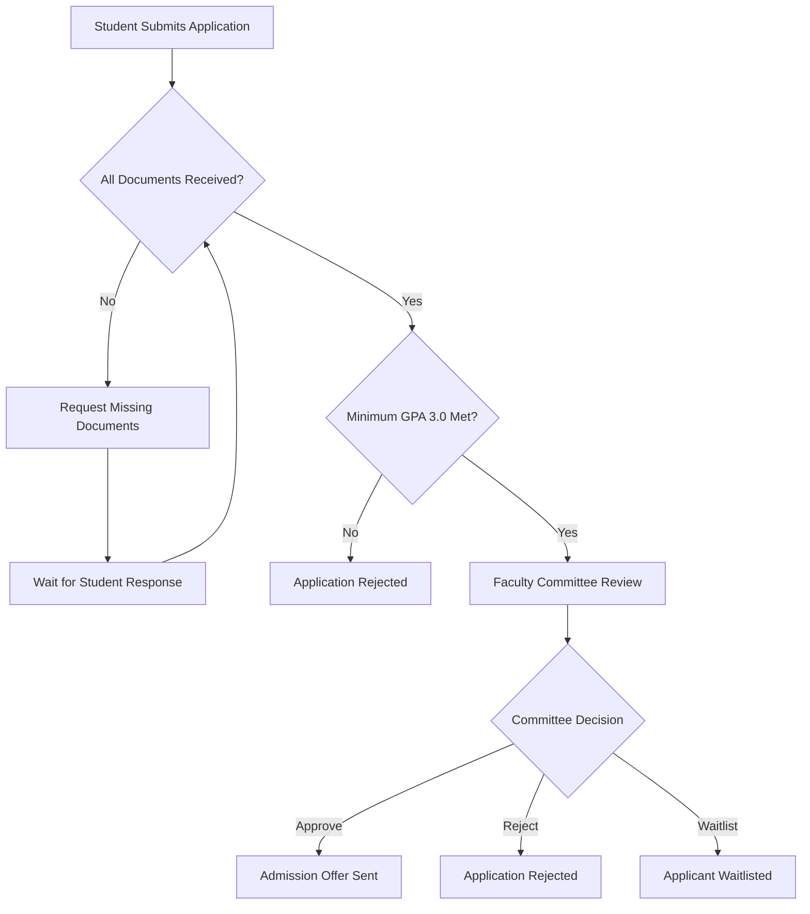

# Metro State Graduate Application Review Process

## Overview

This document describes a fictional graduate application review process used for testing the RAG EVAL 2.0 system.

Applicants must submit an application, official transcripts, and a statement of purpose.

## Application Review Workflow

The following Mermaid diagram illustrates the application review process.

## Additional Requirements

Applicants must submit all required documents by December 1, 2026.

The application fee is $50.

## Important Notes

The workflow above is fictional and intended exclusively for testing Mermaid diagram ingestion and retrieval.
